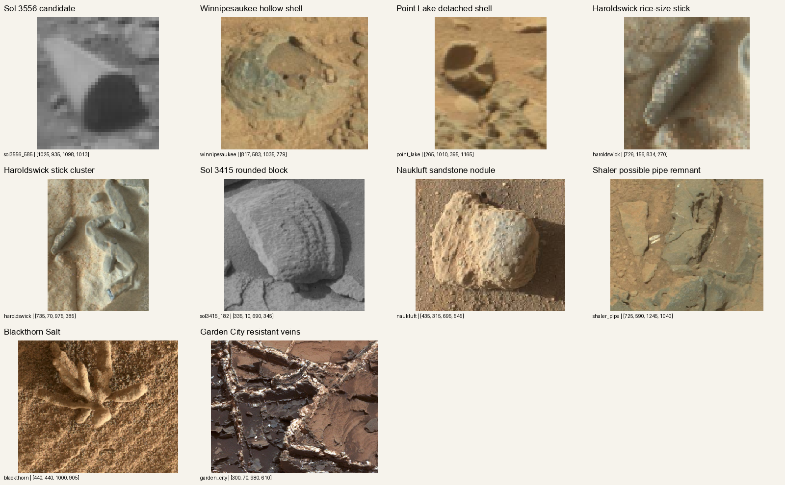
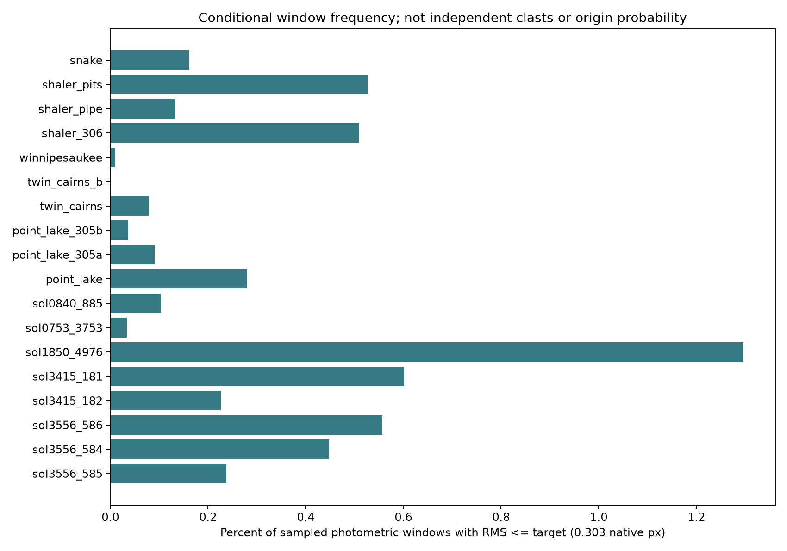
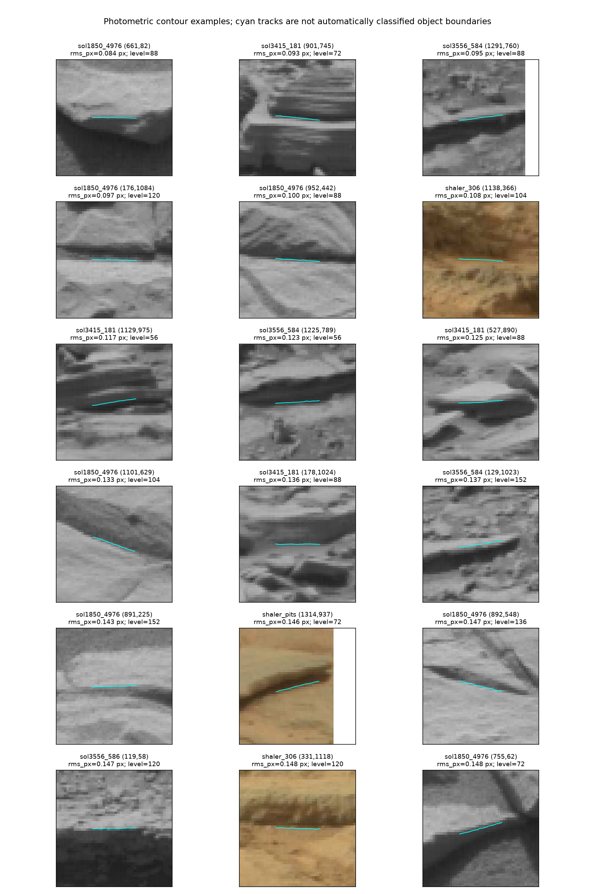
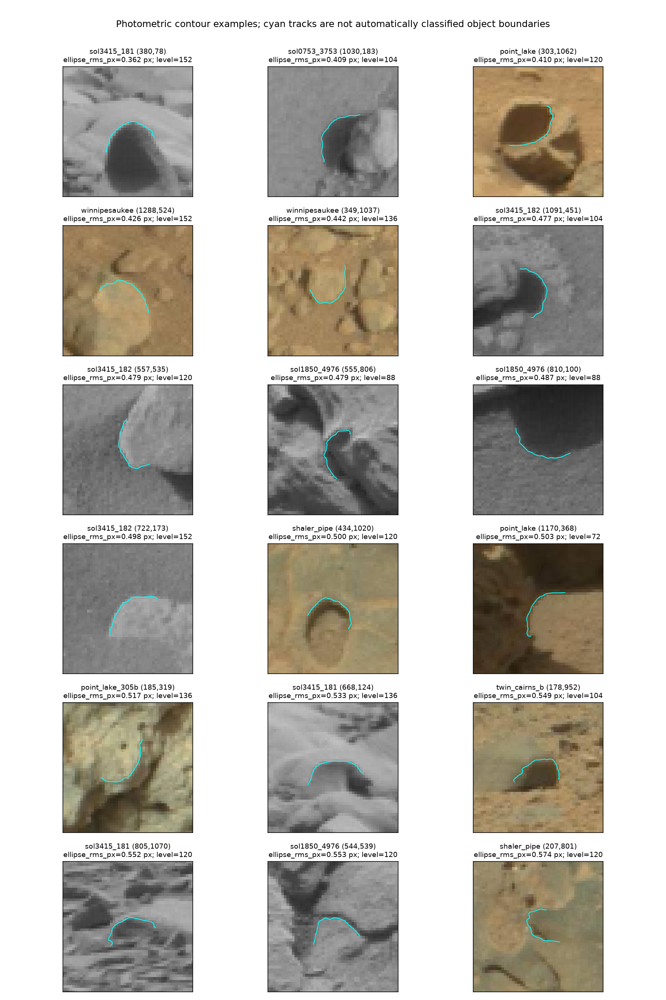
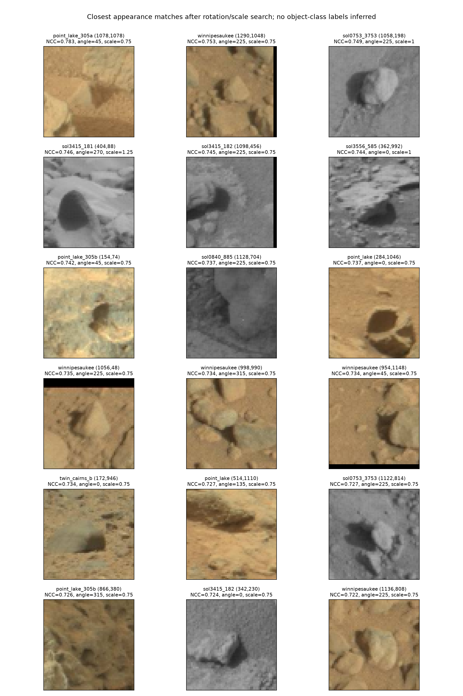
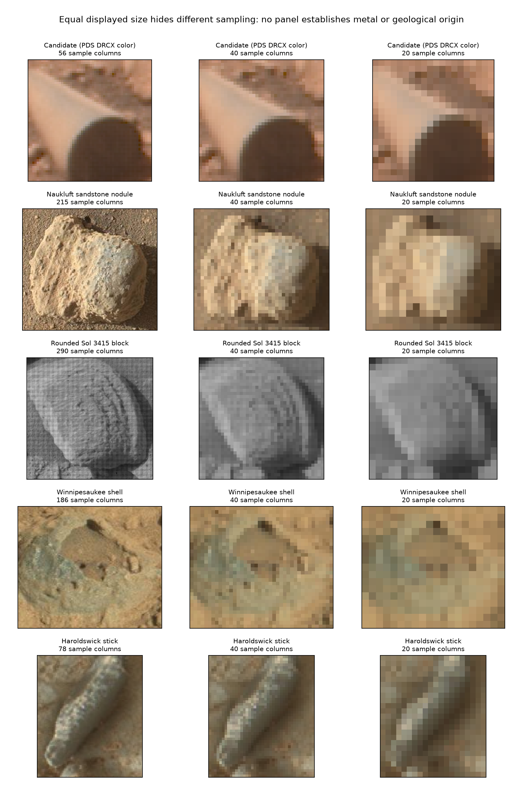

# Curiosity geological comparison study

**Date:** 13 November 2026  
**Reference:** Sol 3556 candidate, Mastcam product 3556MR1025170721700585C00  
**Scope:** 28 retrieved Curiosity images; 18 whole Mastcam frames measured uniformly; 10 captioned geological/context images; deliberate analogue selection, not a probability sample of Gale Crater.

## Assessment

The target retains an unusually straight upper boundary in this comparison, but straightness alone is demonstrably not unique. The broader geological record also contains relevant natural ingredients: rounded nodules, hollow shells, resistant elongate vein remnants, and structures interpreted as sedimentary pipes. This materially improves the geological alternatives over a comparison with three rough nearby clasts.

The study does **not** establish a natural duplicate of the complete front-rim/body/rear-arc configuration. It also does **not** measure the frequency of that conjunction or establish artificial origin. A low residual, a visual resemblance, a hollow concretion, and a fully constrained cylinder fit answer different questions. The exact conjunction remains the part of the argument for which a properly validated population comparison is missing.

The strongest defensible interpretation is: **an unusually regular cylindrical candidate with relevant geological analogues and unresolved origin**, rather than either a proven manufactured part or a feature made ordinary merely by finding a vaguely similar rock.

## What was collected

All photographs are from Curiosity, so all locations are within Gale Crater. The corpus includes the candidate and two same-sequence neighbors (sol 3556); additional scenes on sols 753, 840, 1850, and 3415; and published geological challenge frames from Shaler, Point Lake, Twin Cairns Island, and Winnipesaukee (sols 121–654). The captioned set adds Sheepbed spherules, Jura crystal shapes, Haroldswick sticks, a Naukluft sandstone nodule, Garden City veins, Blackthorn Salt, Greenheugh ventifacts, and two later terrain/context views.

Images were downloaded afresh from NASA. The manifest records URLs, dimensions, byte counts, image hashes, and caption provenance where available. One requested Tochatwi raw frame returned HTTP 403 and was excluded, with its failure retained in the manifest. Its published description remains relevant literature evidence, not a measured frame in this study. No Opportunity, Spirit, Perseverance, orbital, terrestrial, or generated image enters the comparison corpus.

Several frames share outcrops, camera sequences, or viewpoints. Eighteen frames are not eighteen independent regional samples. The older archived survey was not reused as evidence of a 0/185 conjunction rate: it mixes measurement definitions and labels a sol 753 frame as Garden City despite Garden City's later mission chronology.



**Figure 1.** Deliberately selected challenge crops. Equal panel dimensions are display normalization, not equal physical scale. Crops and selection notes are in `selected-features.json`. These include stronger geological comparisons than generic jagged clasts, but they are not asserted to be exact cylinder matches.

## Uniform measurement method

Several single-channel raw JPEG previews show strong pixel-periodic sampling patterns; older released frames are color products. Every quantitative image therefore received the same 2x2 area average before contour extraction. Coordinates, lengths, and residuals were then converted back to equivalent original-image pixels. This removes the most obvious periodic pattern at the cost of spatial resolution. It is not a radiometric calibration, a common camera point-spread function, or equal physical sampling.

Luminance contours were extracted at 24, 40, ..., 232 DN after Gaussian smoothing. Windows used 26 equally spaced contour samples across a 36.4-native-pixel arc span, with half-span strides. Windows near image boundaries, low-gradient windows (median below 2 DN/native px), and the candidate region itself were excluded from the control distribution. Sky/horizon regions were excluded from the distant Twin Cairns frames. Straightness is orthogonal total-least-squares line RMS.

The target boundary was located by proximity to the pre-existing erf dorsal stations, rather than selecting a low residual. For each threshold, the spatially closest eligible window was retained; the closest of those to the recorded boundary is the main comparison. All retained thresholds remain in `results.json`, including those that deviate into neighboring transitions. No target uncertainty in millimeters is transferred to control frames.

These are **photometric windows**, not automatically classified rock objects. They can trace material edges, shadow edges, fractures, internal shading, or textures. Their overlap and repeated thresholds make them correlated. For that reason there is no binomial confidence interval, no independent-clast count, and no probability of natural or artificial origin.

## 1. Straightness: unusual, with measured counterexamples

The contour closest to the recorded upper boundary is at 152 DN. It gives **0.303 native px RMS** across 36.4 native px, at 29.48 degrees. Its average distance from the recorded erf stations is 0.601 px. The original full-resolution erf result, 0.2422 px, remains a separate measurement and was not ranked against coarser control contours.

Among **226,426** control windows, **835 (0.369%)** are at least as straight. This supports unusual local regularity but directly contradicts a claim that no natural-scene edge can attain comparable image-plane straightness. At least one qualifying window occurs in 17 of the 18 measured frames.

Restricting controls to gradients between half and twice the target's median gradient leaves 148,839 windows, of which 694 (0.466%) qualify. Comparable contrast does not eliminate the examples.

The look-elsewhere effect matters: 391 of 6,374 occupied 64x64-native-pixel cells (6.13%) contain at least one qualifying segment. These cells are only a spatial grouping, not independent clasts; they show how searching for the best edge changes the interpretation of a small window fraction.

| Frame | Control windows | At least as straight | Conditional fraction |
| --- | ---: | ---: | ---: |
| sol3556_585 | 20,192 | 48 | 0.238% |
| sol3556_584 | 17,845 | 80 | 0.448% |
| sol3556_586 | 21,557 | 120 | 0.557% |
| sol3415_182 | 8,393 | 19 | 0.226% |
| sol3415_181 | 24,116 | 145 | 0.601% |
| sol1850_4976 | 14,425 | 187 | 1.296% |
| sol0753_3753 | 2,974 | 1 | 0.034% |
| sol0840_885 | 13,455 | 14 | 0.104% |
| point_lake | 10,752 | 30 | 0.279% |
| point_lake_305a | 8,789 | 8 | 0.091% |
| point_lake_305b | 13,564 | 5 | 0.037% |
| twin_cairns | 5,090 | 4 | 0.079% |
| twin_cairns_b | 4,749 | 0 | 0.000% |
| winnipesaukee | 10,415 | 1 | 0.010% |
| shaler_306 | 14,511 | 74 | 0.510% |
| shaler_pipe | 5,320 | 7 | 0.132% |
| shaler_pits | 11,763 | 62 | 0.527% |
| snake | 18,516 | 30 | 0.162% |



**Figure 2.** Frequencies use the same contour method and native-equivalent span for target and controls. They describe this image/window selection, not geological population rarity.



**Figure 3.** The 18 displayed examples were spatially separated before selection. Inspection shows many tracks along clast/bedrock boundaries or their shadow margins, not complete cylindrical objects. In particular, examples in the target's neighboring sol 3556 frames provide close acquisition-context comparisons. These are counterexamples to uniqueness of one straight segment, not to the full cylinder conjunction.

### Sensitivity

| Smoothing / span (native px) | Target RMS px | Windows | Matching windows | Conditional fraction |
| --- | ---: | ---: | ---: | ---: |
| sigma0.7_span36.4 | 0.303 | 226,426 | 835 | 0.369% |
| sigma1.2_span36.4 | 0.632 | 175,055 | 7,316 | 4.179% |
| sigma0.7_span24.0 | 0.151 | 372,900 | 657 | 0.176% |

The target remains in the low-residual tail, but its exact rank is preprocessing- and span-dependent. Across the three coarse thresholds near the target at baseline smoothing, RMS ranges from 0.303 to 1.313 px. The two poorer paths depart from the recorded physical boundary toward adjacent brightness transitions. Averaging these indiscriminately would obscure the meaning of the edge measurement. Both the closest-boundary result and threshold sensitivity are retained.

## 2. Rounded arcs and end-face claims

The same photometric contour search identified **599** partial arcs with apparent semi-major axes 14–28 native px, axis ratio 0.65–1.0, and fitted angular coverage 120–220 degrees. These approximately match the candidate's apparent rim size and arc extent. The best control residual is **0.362 px**; examples include curved clast boundaries, hollows, and a conspicuous Point Lake shell edge.

The automatically selected candidate arc gives 0.341 px RMS but differs from the original rim stations by **2.88 px on average**. That is insufficient boundary agreement for a clean target/control rarity ranking. **No rim percentile or “1 in 600” claim is made.** The original 0.1618-px fit used a different estimator, station selection, and outlier handling. Comparing it directly with these threshold contours would unfairly advantage the target.



**Figure 4.** Similar local curvature occurs in natural scenes. A fitted ellipse does not establish a circular plane, an exposed end face, a hollow tube, or matching front and rear diameters.

## 3. Closest overall appearances

A weighted normalized-luminance template of the candidate and its immediate surroundings was searched across all 18 whole frames at eight orientations and three apparent scales (24 transformations per frame). The candidate exclusion region was masked from control retrieval. A positive self-match is 0.99996, which verifies the coordinate/normalization implementation.

The strongest non-self match is in `point_lake_305a` at (1078.5, 1078.5) with correlation **0.783**. Other retrieved patches include ordinary pebbles with directional shadows, fractures, and rounded/rim-like features. Their visual similarity often arises from a bright region next to a dark shadow, rather than the complete cylindrical geometry.



**Figure 5.** These are actual retrieved image crops. The score is not a cylinder likelihood, physical-model goodness of fit, or probability of geological origin. Neither these matches nor their ranking independently establish front/rear cap agreement. None was subjected here to an independently traced counterpart of the original 85-station joint fit.

## 4. Sampling and apparent smoothness



**Figure 6.** Known geological examples were reduced to 40 and 20 sample columns, while the candidate is also shown from its PDS DRCX color product. Grains and surface irregularities become progressively harder to see. Equal display size is not equal physical resolution; these panels isolate a sampling effect rather than match camera optics or lithology.

The supporting CSV records a central-patch high-frequency image proxy. It deliberately is not called a material roughness measurement: the patch can include shading, edges, albedo variation, dust, noise, and different point-spread functions. A lack of visible grains on the candidate cannot be converted into evidence for metal without a radiometrically and optically matched comparison.

Additional JPEG encodings of the PDS color target change the closest-boundary contour RMS non-monotonically (approximately 0.354–0.494 px for qualities 70–100 in the fixed-crop test). This is a measurement-sensitivity demonstration, not a correction to the original lossless-data fit. Compression, image coordinates, and contour thresholds should not be silently mixed.

## 5. Geological mechanisms worth testing

| Comparison | What it explains or challenges | What it does not establish |
| --- | --- | --- |
| Haroldswick sticks, MAHLI sol 1922 | Natural elongated resistant features at small scale; a possible dark-vein-remnant origin is explicitly considered by NASA. | Uniform cylindrical sections, two matching circular ends, or identical origin for the candidate. |
| Winnipesaukee and Point Lake hollow features | Natural shell/rim geometries in Gale; relevant to interpreting apparent openings and rounded margins. | A detached straight constant-diameter body or a demonstrated hollow candidate. |
| Fluidized-sediment pipes | A published natural route to resistant cylindrical structures in Gale. | A direct size/context match: prominent published pipes are largely embedded, vertically oriented structures, not an identified 1-cm horizontal fragment. |
| Naukluft sandstone nodule | A natural roughly 2-cm resistant clast with visible grains and lamination; more comparable size than a distant cliff. | Equal sampling, identical lithology, or equal cylinder-fit precision. |
| Garden City veins / Blackthorn Salt | Differential erosion can preserve linear or complex resistant mineral structures after softer host rock is removed. | That arbitrary precision geometry follows automatically from erosion. |
| Greenheugh ventifacts / ordinary local clasts | Natural straight facets, rounded corners, abrasion, and shadow outlines; useful counterexamples for individual image properties. | A regional baseline for the complete cylinder conjunction. |

Primary literature makes a blanket statement that “natural Gale rocks cannot be smooth or cylindrical” untenable. It does not supply an exact analogue simply by using the word pipe or concretion. The relevant tests are scale, detachment from host rock, cross-section, actual material boundaries, repeated terminal curvature, texture at matched resolution, and composition.

## What remains unusual, and what remains unmeasured

The candidate combines an accurately fitted proximal curve, a straight upper boundary, and rear curvature that admits a closely registered unchanged ellipse. The reference joint cylinder fit remains a reproducible and useful geometric result. The present comparisons weaken arguments based on straightness alone, apparent smoothness, or a vaguely tube-like appearance. They do not invalidate that joint measurement.

The unresolved issue is the population frequency of **all corresponding features on one object**. A valid estimate needs independently identified material edges, prespecified feature definitions, shared extraction/uncertainty treatment, and a control set that can actually resolve both terminal regions. Occluded or unmeasurable control ends must be recorded as missing, not as failed cylinder tests. Multiplying individual feature frequencies, or treating hundreds of thousands of correlated windows as rocks, would fabricate precision.

M4's tangency failure remains a separate physical-model consistency issue. Nothing in this study restores that formulation or turns rejection of it into proof of manufacture.

## Sources and interpretation boundaries

1. [NASA: Haroldswick stick-shaped features](https://science.nasa.gov/resource/stick-shape-rice-size-features-on-martian-rock-haroldswick/). MAHLI focus merge, sol 1922; origin stated as uncertain, possible resistant vein material.
2. [Wiens et al. (2017), hollow concretions and voids](https://doi.org/10.1016/j.icarus.2017.02.003). Describes hollow features and provides the exact Mastcam identifiers used for the challenge frames. These are geological analogues, not an identification of the candidate.
3. [Rubin et al. (2017), fluidized-sediment pipes](https://www.usgs.gov/publications/fluidized-sediment-pipes-gale-crater-mars-and-possible-earth-analogs), [DOI](https://doi.org/10.1130/G38339.1). Resistant structures interpreted as products of sediment fluidization, with contextual evidence such as neighboring deformation and layering.
4. [Ando et al. (2025), diagenetic features below Greenheugh](https://doi.org/10.1029/2024JE008891). Documents smooth-to-rough nodular morphologies and strong spatial/stratigraphic variation; this cautions against assuming three nearby clasts represent Gale's natural range.
5. [Sun et al. (2019), Murray concretions](https://doi.org/10.1016/j.icarus.2018.12.030). Broader morphology/chemistry context over hundreds of meters of stratigraphy, not a candidate-specific shape test.
6. [Bridges et al. (2014), Gale wind abrasion](https://www.usgs.gov/publications/rock-abrasion-record-gale-crater-mars-science-laboratory-results-bradbury-landing). Natural abrasion facets, grooves, and flutes establish relevant surface processes without predicting the candidate's exact geometry.
7. [NASA: Naukluft sandstone nodule](https://www.nasa.gov/image-article/sandstone-nodule-beside-naukluft-plateau-mount-sharp-mars/), [Sheepbed spherules](https://science.nasa.gov/resource/spherules-in-yellowknife-bay-unannotated/), and [Garden City veins](https://science.nasa.gov/resource/garden-city-vein-complex-on-lower-mount-sharp-mars/). Instrument/context captions anchor the selected photographs.

The 2015 conference abstract and 2017 journal study differ in some preliminary size/context descriptions; the later journal paper is preferred for geological interpretation. The abstract is retained as historical context and a route to the cylindrical-feature literature. Text and figures from the papers are not presented as newly measured data.

## Reproduction and deliverables

Use Python 3.12 and `pip install -r audit/comparative-study/requirements.txt`. The scripts are separate from the reconstruction and preserve NumPy 1.26.4. Run:

```text
python audit/comparative-study/scripts/acquire.py
python audit/comparative-study/scripts/acquire_additional.py
python audit/comparative-study/scripts/acquire_final.py
python audit/comparative-study/scripts/build_atlas.py
python audit/comparative-study/scripts/feature_atlas.py
python audit/comparative-study/scripts/analyze.py
python audit/comparative-study/scripts/template_search.py
python audit/comparative-study/scripts/resolution_experiment.py
python audit/comparative-study/scripts/summarize.py
python audit/comparative-study/scripts/write_report.py
python audit/comparative-study/scripts/finalize_data.py
python -m unittest discover -s audit/comparative-study/scripts -p test_analysis.py -v
```

Acquisition needs network access; subsequent analysis is offline. Failed downloads are recorded rather than silently replaced. `image-manifest.json` identifies original images. `comparison-summary.json` contains the directly interpreted edge statistics; `results.json` retains the threshold sensitivity. CSV/GZIP exports contain every measured window and arc. Source coordinates, transforms, and selected examples make the visual comparisons inspectable. Synthetic tests verify rotation-independent line residuals, partial-ellipse recovery, and the actual contour detector on a known straight transition. Positive self-retrieval verifies the appearance search.

## Image inventory

| ID | Sol / caption | Dimensions | Use | Provenance |
| --- | --- | --- | --- | --- |
| sol3556_585 | 3556 | 1328 x 1184 | whole_frame | [source](https://mars.nasa.gov/msl-raw-images/msss/03556/mcam/3556MR1025170721700585C00_DXXX.jpg) |
| sol3556_584 | 3556 | 1328 x 1184 | whole_frame | [source](https://mars.nasa.gov/msl-raw-images/msss/03556/mcam/3556MR1025170711700584C00_DXXX.jpg) |
| sol3556_586 | 3556 | 1328 x 1184 | whole_frame | [source](https://mars.nasa.gov/msl-raw-images/msss/03556/mcam/3556MR1025170731700586C00_DXXX.jpg) |
| sol3415_182 | 3415 | 1152 x 1152 | whole_frame | [source](https://mars.nasa.gov/msl-raw-images/msss/03415/mcam/3415MR1016480001600182C00_DXXX.jpg) |
| sol3415_181 | 3415 | 1328 x 1184 | whole_frame | [source](https://mars.nasa.gov/msl-raw-images/msss/03415/mcam/3415MR1016440141600181C00_DXXX.jpg) |
| sol1850_4976 | 1850 | 1152 x 1152 | whole_frame | [source](https://mars.nasa.gov/msl-raw-images/msss/01850/mcam/1850MR0096810000204976C00_DXXX.jpg) |
| sol0753_3753 | 753 | 1344 x 1200 | whole_frame | [source](https://mars.nasa.gov/msl-raw-images/msss/00753/mcam/0753MR0032370300403753C00_DXXX.jpg) |
| sol0840_885 | 840 | 1344 x 1200 | whole_frame | [source](https://mars.nasa.gov/msl-raw-images/msss/00840/mcam/0840MR0037360500500885C00_DXXX.jpg) |
| sheepbed | caption | 929 x 522 | curated_analogue | [source](https://science.nasa.gov/resource/spherules-in-yellowknife-bay-unannotated/) |
| jura | caption | 3273 x 2884 | curated_analogue | [source](https://science.nasa.gov/photojournal/crystal-shapes-and-two-toned-veins-on-martian-ridge/) |
| haroldswick | caption | 1584 x 1184 | curated_analogue | [source](https://science.nasa.gov/resource/stick-shape-rice-size-features-on-martian-rock-haroldswick/) |
| naukluft | caption | 1041 x 765 | curated_analogue | [source](https://www.nasa.gov/image-article/sandstone-nodule-beside-naukluft-plateau-mount-sharp-mars/) |
| gatorback | caption | 5833 x 3324 | curated_analogue | [source](https://science.nasa.gov/photojournal/curiosity-finds-gator-back-rocks-on-greenheugh/) |
| blackthorn | caption | 1561 x 1167 | curated_analogue | [source](https://science.nasa.gov/image-article/apod-2022-march-9-a-flower-shaped-rock-on-mars/) |
| garden_city | caption | 1505 x 685 | curated_analogue | [source](https://science.nasa.gov/resource/garden-city-vein-complex-on-lower-mount-sharp-mars/) |
| vein_crystal | caption | 628 x 446 | curated_analogue | [source](https://science.nasa.gov/resource/crystal-growth-texture-in-light-vein-at-garden-city/) |
| sticks_3810 | caption | 1200 x 1200 | curated_analogue | [source](https://science.nasa.gov/blog/sols-3812-3813-tiny-sticks-poking-out-at-us/) |
| nodules_3145 | caption | 1024 x 1024 | curated_analogue | [source](https://science.nasa.gov/blog/sols-3146-3148-keep-your-shoes-on/) |
| point_lake | 302 | 1344 x 1200 | whole_frame | [source](https://mars.nasa.gov/msl-raw-images/msss/00302/mcam/0302MR0012570100203802E01_DXXX.jpg) |
| point_lake_305a | 305 | 1344 x 1200 | whole_frame | [source](https://mars.nasa.gov/msl-raw-images/msss/00305/mcam/0305MR0012620110203874E01_DXXX.jpg) |
| point_lake_305b | 305 | 1344 x 1200 | whole_frame | [source](https://mars.nasa.gov/msl-raw-images/msss/00305/mcam/0305MR0012620080203871E01_DXXX.jpg) |
| twin_cairns | 343 | 1344 x 1200 | whole_frame | [source](https://mars.nasa.gov/msl-raw-images/msss/00343/mcam/0343MR0013880020301096E01_DXXX.jpg) |
| twin_cairns_b | 343 | 1344 x 1200 | whole_frame | [source](https://mars.nasa.gov/msl-raw-images/msss/00343/mcam/0343MR0013880040301098E01_DXXX.jpg) |
| winnipesaukee | 654 | 1344 x 1200 | whole_frame | [source](https://mars.nasa.gov/msl-raw-images/msss/00654/mcam/0654MR0027730000401977E01_DXXX.jpg) |
| shaler_306 | 306 | 1344 x 1200 | whole_frame | [source](https://mars.nasa.gov/msl-raw-images/msss/00306/mcam/0306MR0012670140203944E01_DXXX.jpg) |
| shaler_pipe | 308 | 1344 x 1200 | whole_frame | [source](https://mars.nasa.gov/msl-raw-images/msss/00308/mcam/0308MR0012730520204018E01_DXXX.jpg) |
| shaler_pits | 121 | 1344 x 1200 | whole_frame | [source](https://mars.nasa.gov/msl-raw-images/msss/00121/mcam/0121MR0007560110200724E01_DXXX.jpg) |
| snake | 173 | 1408 x 1200 | whole_frame | [source](https://mars.nasa.gov/msl-raw-images/msss/00173/mcam/0173MR0009260660201874E01_DXXX.jpg) |

Original image credits: NASA/JPL-Caltech/MSSS; Navcam terrain-context views: NASA/JPL-Caltech. Analytical overlays, plots, and interpretations are new to this study. The study is exploratory and reproducible; it is not an exhaustive inventory of Curiosity imagery or a calibrated origin classifier.
