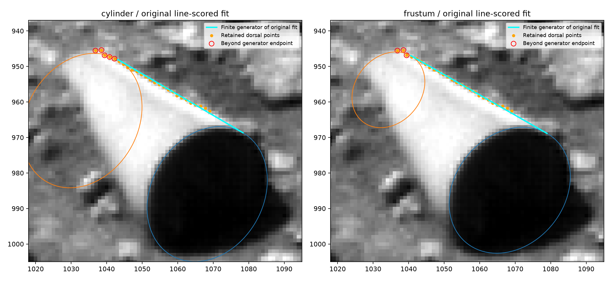

# Reassessment against the earlier M4 analysis

The previous conversational interpretation overstated the new frustum result. Its lower prediction error revisits the same axis and rear-radius tradeoff present in M4. Review also exposed an omitted finite-generator constraint in the new scoring code.

The earlier eight-parameter M4 solution has radius ratio 0.618699, projected axis 39.3265 degrees and total RMS 0.254921 pixels. Its fitted upper line intersects its end ellipse. The intercept is 19.294848 pixels, while true tangency requires 19.433711 pixels. This algebraic defect remains reproducible. [Earlier checked derivation](../model-comparison.md)

The seven-parameter camera-projected frustum gives radius ratio 0.603894, axis 39.6464 degrees and full-fit RMS 0.252629 pixels under the original extended-line scoring. Its front/rear/dorsal errors are 0.1923/0.2820/0.2923 pixels. Old M4 gives 0.1930/0.2684/0.3096 pixels. The close correspondence shows how directly the new result revisits the old fitted geometry. The corrected construction satisfies the surface-normal tangency equation, independently checked at three axial positions on each generator. [Saved comparison](results/m4-reevaluation.json)

## Finite extent changes the interpretation

The first physical model scores the dorsal family against the infinite line through the two generator endpoints. Five of 26 dorsal stations extend past the rear endpoint of the original cylinder fit. Three extend past the rear endpoint of the original frustum fit. Their axial fractions reach 1.1639 and 1.0901 respectively, with the rear endpoint defined as 1. Thus the original scores omit a constraint required to call every dorsal station a measurement of the finite body's generator.

| Scoring and fitting condition | Circular segment RMS px | Frustum RMS px |
| --- | --- | --- |
| Original fit, extended tangent line | 0.3782 | 0.2526 |
| Original guarded prediction, extended tangent line | 0.7201 | 0.3856 |
| Original parameters, distance to finite generator | 1.1157 | 0.5844 |
| Refit using finite-generator distances | 0.7717 | 0.3946 |
| Guarded prediction using finite-generator refits | 1.9363 | 0.7176 |

Both finite refits use the original station weights, the same three starting bearings, the same five guarded folds and the original parameter bounds. The finite frustum radius ratio shifts to 0.4548. Its five guarded training fits yield ratios from 0.4121 to 0.5276. No fitted parameter reaches its bound. Endpoint distances enter the residual continuously, so some stations can retain endpoint mismatch after refitting. The cylinder and frustum fit front/rear/dorsal families at 0.5941/0.6266/1.0532 and 0.2443/0.4182/0.5171 pixels respectively. These tests preserve all selected points and quantify their finite-generator mismatch.

This is a later exploratory sensitivity prompted by the user's request. The original frozen tests and scores remain recorded. The finite-distance comparison still gives smaller errors for taper on these coordinates. Its changed optimum and increased errors qualify the earlier claim about a complete physical shape. A material-boundary selection review could determine whether the early dorsal stations belong to a terminal curve or another transition. That review has not been performed here.

## What transfers from the earlier objections

The fixed-front rear-scale scan has a minimum near 0.93. Its equal-size case changes raw RMS by only 0.00195 pixels. At low scale, it fits worse under its frozen front shape and orientation. The jointly fitted taper changes those quantities and the rear center. Applying the frozen-front scan's large deviance to that changed model would mix different hypotheses. The earlier checked audit already records this distinction. [Rear-scale audit](../model-comparison.md)

The older bisector and ventral-brightness arguments assign the lower diagonal to a second exposed conical generator. A tapered body partly covered by foreground terrain assigns that diagonal to an occlusion boundary. Those tests address different visible-boundary configurations. A full foreground-occluded frustum scene has yet to be fitted to both boundaries, shadows and radiance. The current finite-generator test checks coordinates only. Existing shading and shadow analyses require their own matched forward comparison before they can establish an advantage for either surface.

The earlier M4 rejection remains valid for its tangent construction. The corrected taper has a valid tangent construction and an incompletely validated image interpretation. The original measurements continue to reproduce. The revised evidence permits further examination of taper while withholding a claim that the full image establishes it or selects an origin.
