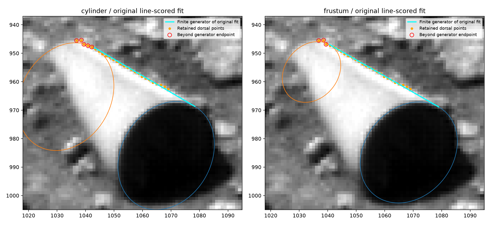
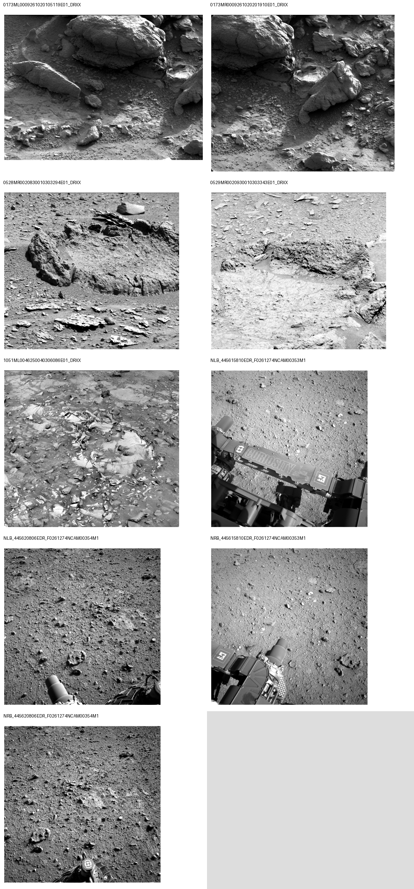
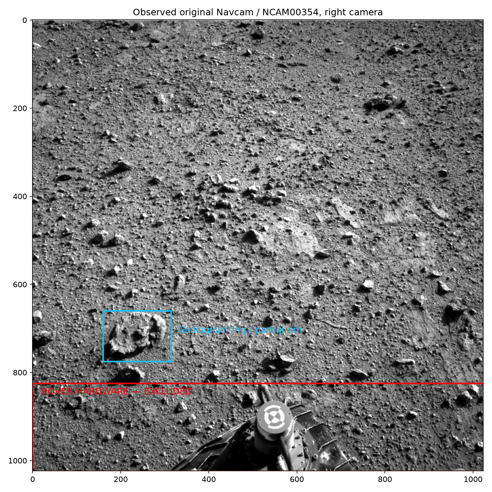
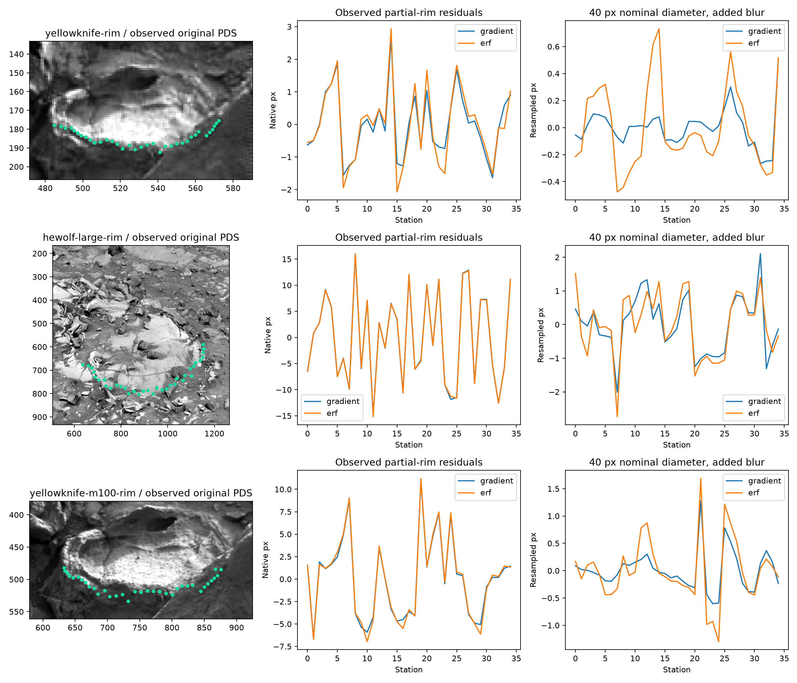
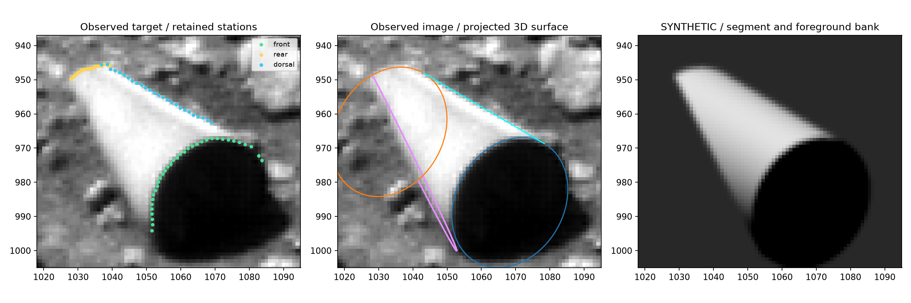
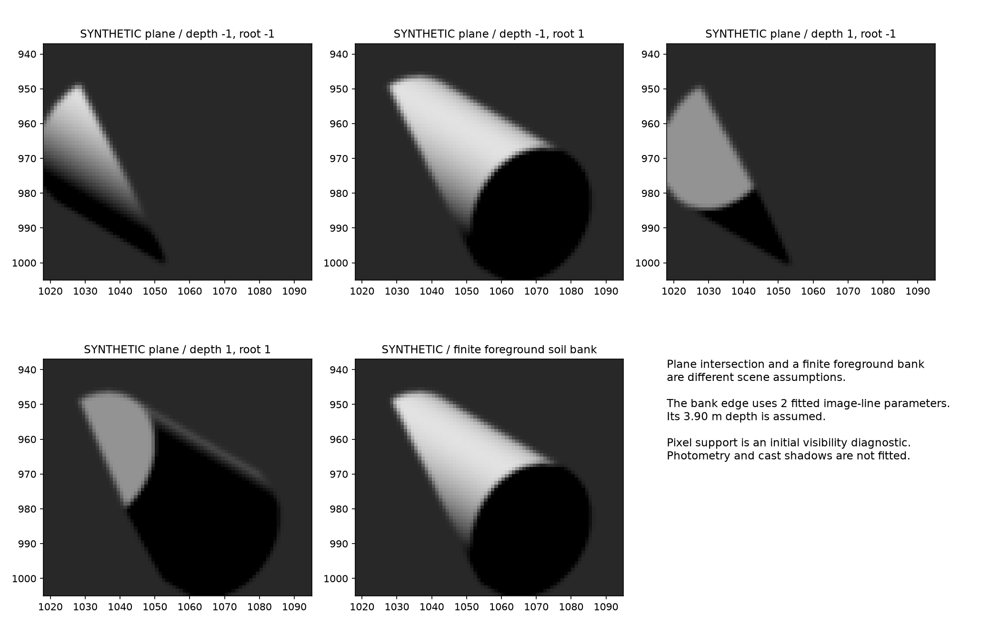
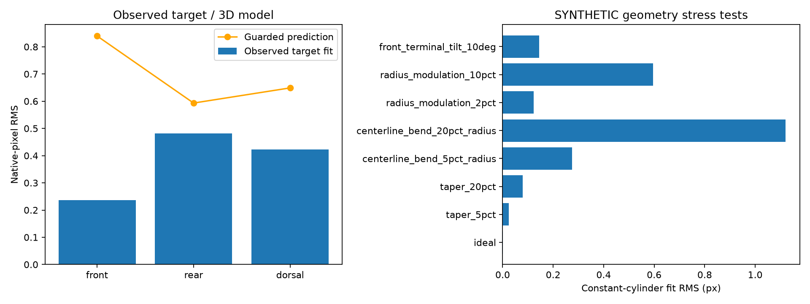

# Fluidized-sediment pipes and the Sol 3556 cylindrical candidate

Research report, 13 November 2026. Isolated branch `audit/sediment-pipe-comparison`.

## Abstract

This investigation reproduces the target benchmark, retrieves nine original PDS products covering all four requested Mars locations, screens fifteen original or published views, measures three partial-rim views of two geological objects, and fits a finite three-dimensional circular segment through the target's CAHVOR camera. With terminal-conic and extended-tangent-line scoring, the circular-segment model fits the retained 85 points at 0.3782 pixels RMS and predicts guarded withheld points at 0.7201 pixels. The original image-plane benchmarks reproduce to their reported precision. The geological images inspected here expose no complete N+R+D configuration of one object. Their partial-rim results therefore address local curvature only. A planar burial-contact fit passes a coordinate-distance check but can fail scene visibility. An exploratory finite foreground-bank rendering retains a visible segment behind a soil edge, with assumed bank depth and simplified reflectance. The original scores omit finite generator endpoints. The reevaluation below adds that constraint and revises the physical interpretation. They do not establish the probability, production history, or a fully validated natural analogue of the target.

## Reevaluation against earlier M4 data

The original 0.2526/0.3856-pixel frustum scores use an extended tangent line for the dorsal family. They cannot be presented as full finite-body validation. Five of the cylinder's 26 dorsal points and three of the frustum's lie beyond their fitted rear generator endpoints. Holding the original parameters fixed and measuring distance to the finite generator changes total RMS to 1.1157 pixels for the cylinder and 0.5844 pixels for the frustum.

Refitting with finite-segment distances gives cylinder full-fit RMS 0.7717 pixels and guarded RMS 1.9363 pixels. The corresponding frustum scores are 0.3946 and 0.7176 pixels, with fitted rear/front radius ratio 0.4548. This stricter sensitivity still favors taper on these coordinates, while increasing errors and changing the fitted taper. Points can retain nonzero endpoint errors after refitting. Complete scene visibility and photometry remain unvalidated.

The earlier M4 optimum already showed essentially the same geometric tradeoff: rotating the axis to 39.33 degrees and shrinking the rear section to s=0.6187. Its intercept was 0.138863 pixels short of true ellipse tangency. The later camera-projected frustum satisfies surface tangency, so that specific rejection does not transfer automatically. The standalone rear-scale scan held the front ellipse fixed and cannot be assigned as a likelihood-ratio rejection of a model that changes front shape, orientation and rear center. Earlier bisector and ventral-brightness objections assume that the lower diagonal is a second exposed generator. A foreground-occluded frustum has a different boundary assignment.

The earlier conversational claim that the tapered fit changed confidence in the complete shape was premature. The completed result concerns a conditional geometric alternative with a revised endpoint sensitivity. See `m4-reevaluation.md`, `results/m4-reevaluation.json` and the figure below.

## 1. Question and scope

Can a documented fluidization, cementation, exhumation and truncation history yield an object whose observed near section, far section and exterior boundary reproduce this target? The evaluation distinguishes published examples, measured original-image controls, and explicitly synthetic geometry experiments. Full N+R+D tests require two termini of the same body. Eligibility concerns observation geometry and supplies no failure statistic for concealed features.

The existing root research ZIP was inspected as prior work. It contains publication screening and a synthetic fitting scaffold. It contains no original geological station measurements. The present work adds original PDS acquisition, partial-rim metrology, target benchmark replay and an actual 3D camera-projected model. Previous analyses and the technical manuscript were not edited.

## 2. Frozen protocol and source correspondence

`protocol.md` was committed before this study's new fits in commit `922606f`. Original-image selections and the first physical-model amendment were committed in `1754bd8`. The later M100 selection and exploratory extensions were recorded in `d664b14`. Parent HEAD is `623ed7758098affc68515852024cddc0702f0178`. The current manuscript and predictive-validation additions were working-tree products, so their exact SHA-256 hashes are recorded in `sources/baseline.json`. The committed reconstruction history alone does not identify every November 13 manuscript addition.

The target replay copies the existing validation implementation with its root/output locations adapted. It imports the established tracked extraction, rear-terminus and orthogonal-distance routines. It writes only under this study. `results/target-benchmark/results.json` preserves every fold, start, parameter and scored residual. `boundary-inventory/target-*.json` preserves the actual coordinates used. Source and manuscript invariance are tested against the pre-study hashes.

| Measurement | Reproduced | Assignment benchmark |
| --- | --- | --- |
| Near rim stations | 35 | 35 |
| Rear stations | 24 | 24 |
| Dorsal stations | 26 | 26 |
| Total observations | 85 | 85 |
| Strict six-parameter fit RMS | 0.3788 | 0.3788 |
| Six-anchor / 18-withheld rear RMS | 0.2084 | 0.2084 |
| Guarded rear RMS | 0.2429 | 0.2429 |
| Guarded three-feature RMS | 0.7233 | 0.7233 |
| Dorsal TLS straightness RMS | 0.2422 | 0.2422 |

The descriptive joint fit uses the source station weights and reports raw pixel RMS. Frozen rear prediction estimates two rear translation coordinates using six anchors. The other eighteen rear points do not influence registration. Guarded folds exclude adjacent stations as recorded in the source protocol. The three-feature folds withhold a block from each family. These tests reuse the original feature selection and supply coordinate-level predictive checks.

## 3. Geological literature and process categories

Rubin et al. describe resistant annular outcrops interpreted as sediment injection pipes. Their figures predominantly expose sections through embedded structures. Their discussion and field analogues support vertical pipe formation, cementation contrasts and erosion-resistant columns. The Yellowknife diameter differs between the running text and Table 1, and the supplement contains image/sol inconsistencies. Those discrepancies are retained. [Rubin et al.](https://doi.org/10.1130/G38339.1), [supplement 2017002](https://doi.org/10.1130/2017002).

The Paria Plateau field guide illustrates sandstone columns weathered from surrounding strata and describes liquefaction, fluidization, subsequent diagenesis and erosion. It provides an exposed-column analogue for those stages. Its published photographs leave the bases embedded and supply no independently measured pair of end boundaries. The precise millimetre-scale regularity and terminal fracture orientations assumed in the segment experiment remain exploratory. [Wheatley, Seiler and Chan, 2019](https://pdfs.semanticscholar.org/662e/74839bf014863d96bb204f4543ea7c213c2e.pdf).

Loope et al. provide a strong separate natural morphology example in Figure 6B, with long rinded pipes weathered from sandstone. Their interpretation involves iron-oxide precipitation around reaction fronts. Their observed pipes can have diffuse distal ends. This mechanism is inventoried separately from injected sediment. [Loope et al., 2011](https://doi.org/10.1086/661110).

Hunter et al. document pipes interpreted as solution-collapse structures in New Mexico. Their exposed large columns expand the morphological search but retain a distinct formation interpretation. The source was screened for observable termini rather than automatically pooled with fluidization pipes. [Hunter et al., 1992](https://pubs.usgs.gov/bul/1808l/report.pdf).

Additional searches inspected the primary publisher record for Wheatley et al. (2016), DOI 10.1016/j.sedgeo.2016.03.027, and the broader Mars review by Broz et al. (2023), DOI 10.5194/esurf-11-633-2023. The former full primary-camera imagery was unavailable here. The latter helped verify full image identifiers. No terrestrial publication photograph received subpixel metrology.

## 4. Original-image provenance and screening

The original archive arrays, detached labels and download/failure logs are under `sources/`. `image-manifest.csv` records full IDs, instruments, dates, sols, processing levels, dimensions and checksums. PDS labels govern acquisition metadata. `pds_images.py` reads big-endian band-sequential Mastcam radiometric arrays and applies their labeled band scaling. It reads Navcam signed 16-bit data from the record pointer past the VICAR/ODL headers. All nine products decode to their labeled dimensions.

The GSA supplement was recovered through Figshare article 12534422, file 23302604. The legacy GSA URLs failed. The listed Yellowknife left-camera product is `0173ML0009261020105119E01_DRXX`. Eleven official M100 camera labels were used to localize the same terrain and retrieve `0173MR0009261020201910E01_DRXX`. The latter matches the terrain in the published high-resolution ring view. The localization used the left-image focus-distance scenario only to identify a field of view, without treating it as measured range.

Tappers was retrieved as `0528MR0020830010303294E01_DRXX` and the supplementary close-up as `0529MR0020930010303343E01_DRXX`. The supplement's C00 version hint was unavailable in that RDR directory. The archive lists E01 for the acquisition. Marias Pass is `1051ML0046250040306086E01_DRXX`. The four full-resolution Navcam products cover left/right cameras for clocks 445615810 and 445620806, sequences NCAM00353 and NCAM00354. The target geological ring is distinct from the foreground rover hardware.

The inventory contains repeated views of objects, so image count and independent-object count differ. Nine PDS images and six additional publication views were screened. The three measured image views cover the Yellowknife ring twice and the larger Hewolf ring once.

| View / object | Mechanism category | N | R | D | Classification |
| --- | --- | --- | --- | --- | --- |
| 0173ML0009261020105119E01_DRXX | interpreted sediment injection pipe | one exposed section | unobservable | unobservable | Eligible for partial geometric comparison |
| 0173MR0009261020201910E01_DRXX | interpreted sediment injection pipe | one exposed section | unobservable | unobservable | Eligible for partial geometric comparison |
| 0528MR0020830010303294E01_DRXX | interpreted sediment injection pipe | one section visible, precise material/relief contour ambiguous | unobservable | no complete axial generator | Ambiguous boundary identification |
| 0529MR0020930010303343E01_DRXX | interpreted sediment injection pipe | one section visible, precise material/relief contour ambiguous | unobservable | no complete axial generator | Ambiguous boundary identification |
| 1051ML0046250040306086E01_DRXX | interpreted sediment injection pipe | one exposed section per object | unobservable | unobservable | Eligible for partial geometric comparison |
| NLB_445615810EDR_F0261274NCAM00353M1 | interpreted sediment injection pipe | one section in context, not traced | unobservable | unobservable | Eligible for partial geometric comparison |
| NLB_445620806EDR_F0261274NCAM00354M1 | interpreted sediment injection pipe | one section in context, not traced | unobservable | unobservable | Eligible for partial geometric comparison |
| NRB_445615810EDR_F0261274NCAM00353M1 | interpreted sediment injection pipe | one section in context, not traced | unobservable | unobservable | Eligible for partial geometric comparison |
| NRB_445620806EDR_F0261274NCAM00354M1 | interpreted sediment injection pipe | one section in context, not traced | unobservable | unobservable | Eligible for partial geometric comparison |
| rubin-4a | interpreted fluidized-sediment pipe | one top section | unobservable | side margin visible | Eligible for partial geometric comparison |
| rubin-4b | interpreted fluidized-sediment pipe | one section | unobservable | unobservable | Eligible for partial geometric comparison |
| paria-5b | interpreted liquefaction/fluidization pipe | one top section | unobservable | side margin visible | Eligible for partial geometric comparison |
| paria-5c | interpreted liquefaction/fluidization pipe | top partly visible | unobservable | side margin visible | Eligible for partial geometric comparison |
| loope-6b | iron-oxide reaction-front concretion | some cross sections | unobservable | side margins visible | Eligible for partial geometric comparison |
| hunter-12 | probable solution-collapse pipe | unclear | unobservable | column margin visible | Insufficient observational geometry |

The two Hewolf rings are separate objects. None was treated as a near/far pair. The Navcam ring views and terrestrial columns remain available for partial work. Exact station measurements were completed only for the three selected Mastcam arcs. Tappers' rough multi-surface rim remains ambiguously segmented. These are explicit empirical limits on this study.

## 5. Observed partial-rim metrology

Selections in `control-selections.json` precede fitting each view. They define center, approximate ellipse radii, angle range, sample count, search width and gradient polarity. All 35 stations per selection are retained. Directed gradient maxima use parabolic localization. The second method fits a local error-function transition. Failed error-function optimizations retain a recorded gradient fallback. All profiles, uncertainties, decisions and coordinates are saved before fits in `boundary-inventory/`.

Free geometric ellipse fits minimize orthogonal distances using the same distance routine as the target. They use unweighted fitting because the control transition-error estimates are strongly affected by texture. The target benchmark retains its original weights. This difference is explicit. Neither partial-rim fit is an 85-point joint comparison. Rear, longitudinal, frozen rear-transfer and joint holdout scores remain unavailable for these controls.

Both fitted ellipse diameter and the preselected width reference are reported. A short arc can imply a large concealed ellipse, as the Yellowknife left-camera result demonstrates. Primary normalization therefore uses the width reference declared before fitting. The fitted-diameter normalization also remains in JSON. The arc coverage differs from the target and its identifiability depends on that coverage.

| Observed view | Extractor | Native RMS px | Width reference px | RMS / reference | Fitted ellipse diameter px | Resampled RMS px | Resampled guarded RMS / reference |
| --- | --- | --- | --- | --- | --- | --- | --- |
| yellowknife-rim | gradient | 0.9950 | 88.0 | 0.01131 | 246.1 | 0.1431 | 0.01341 |
| yellowknife-rim | erf | 1.1535 | 88.0 | 0.01311 | 232.0 | 0.3042 | 0.05297 |
| hewolf-large-rim | gradient | 8.7881 | 560.0 | 0.01569 | 551.3 | 0.8517 | 0.09541 |
| hewolf-large-rim | erf | 8.7875 | 560.0 | 0.01569 | 550.2 | 0.9541 | 0.07378 |
| yellowknife-m100-rim | gradient | 4.3913 | 256.0 | 0.01715 | 241.9 | 0.3618 | 0.02440 |
| yellowknife-m100-rim | erf | 4.5599 | 256.0 | 0.01781 | 242.0 | 0.5827 | 0.02471 |

The resampling experiment antialiases and reduces each control to a nominal 40-pixel width reference, with Gaussian blur equivalent to 0.7 output pixels, then repeats both extraction methods. This controls apparent size and an added blur kernel. The original optical PSFs are uncalibrated, so the effective blur is only approximately matched. Seed radii at 0.9 and 1.1 times their declared values are retained in JSON, including their failed or unstable fits. No view was selected by its eventual residual.

Visual review of these overlays shows an important extraction limit: several stations respond to local texture, broken contacts or neighboring relief rather than one continuously identifiable material edge. This is especially clear in the M100 Yellowknife view and the fragmented Hewolf arc. Those stations are retained as required by the frozen protocol. The reported errors quantify this operational extraction-and-fit procedure; they must not be read as precise estimates of intrinsic geological boundary roughness. Agreement between the gradient and error-function procedures is not independent confirmation of feature identity, because both use the same seeded profiles. A blinded material-boundary annotation remains necessary for a stronger comparison.

These measurements demonstrate observable natural curved sections and quantify the extraction/partial-arc problem. They supply no empirical frequency for the full target configuration. No numerical geological-control N+R+D fit was possible from the screened exposures.

## 6. Physical forward model

`physical_model.py` defines a finite right-circular segment in rover coordinates. Six independent parameters specify a front-center viewing ray (two), radius, physical axial length through a projected-span parameter, projected axis bearing and angle to the viewing ray. Range is fixed at 3.957 m. Both axis depth signs are tested. Radius and length scale with the assumed range. Near and rear circles and the actual tangent generators are projected through the retained CAHVOR model. Tangency follows the camera-to-surface viewing condition. The rejected M4 image-plane construction is never used.

At the fitted range, diameter is 11.791 mm, axial length 19.362 mm and viewing tilt 38.422 degrees. These are scenario dimensions. The projected circles' conic approximation RMS is below 0.000141 pixels, far below the measured residuals. The local lens distortion approximation is therefore recorded and checked.

The natural process scenario has five stages. Injection forms an approximately columnar sediment body. Preferential cementation preserves a resistant portion. Erosion exposes the body. Fracture or erosional truncation produces finite ends. Later terrain conceals part of the surface. Published examples support the first three stages in broad terms. The combination of an approximately constant section at this size, near-normal terminal truncations, detachment history and the particular burial arrangement is assumed for the geometric experiment. This work does not solve sediment transport, cement kinetics or fracture mechanics, and supplies no geological distribution for those assumptions.

| Experiment | RMS px | Fitted parameters | Scored observations |
| --- | --- | --- | --- |
| 3D circular segment, full target fit | 0.3782 | 6 | All 85 target points fitted |
| 3D circular segment, guarded prediction | 0.7201 | 6 | Every target point withheld once |
| 3D length-only rear registration | 0.6677 | 1 | 18 points withheld after six anchors fit length |
| Infinite plane / cylinder contact | 0.1822 | 3 | Separate soil-contact coordinate fit |
| Finite foreground bank edge | 0.1873 | 2 | Separate 2D edge fit with assumed depth |
| Physically tangent frustum, full fit | 0.2526 | 7 | All 85 target points fitted |
| Physically tangent frustum, guarded prediction | 0.3856 | 7 | Same guarded folds; exploratory |

The guarded 3D test uses the same heldout indices and guard bands as the benchmark. Each of the six parameters is refitted using training coordinates only. Three starting bearings are tried and training objective selects the solution. All successful starts, parameter vectors, bounds and Jacobian singular values are retained. These original scores compare the terminal conics and an extended tangent line. The finite-generator reevaluation below identifies an additional physical constraint omitted from those scores.

The length-only rear experiment freezes five parameters estimated from front and dorsal stations and fits one axial length to the six anchors. Its larger withheld error of 0.6677 pixels is retained. This has a stronger collinearity requirement than two-coordinate rear registration. It demonstrates that the reported 0.2084-pixel result depends on the permitted registration, and cannot be substituted for this one-parameter prediction.

### Exposure and visibility

Twenty-six existing soil-contact stations independently constrain an added three-parameter plane. The best plane/cylinder curve distance is 0.1822 pixels. Its first rendering nevertheless hides all near-rim and dorsal station neighborhoods. That combination fails the image's visible-boundary requirement. The four depth/root cases are retained below. Pixel support within one pixel is an initial diagnostic that does not itself prove that a specific terminal curve is an exposed edge.

| Axis depth sign | Cylinder ray root | Contact RMS px | N pixel support / 35 | R support / 24 | D support / 26 |
| --- | --- | --- | --- | --- | --- |
| -1 | -1 | 0.1822 | 0 | 4 | 0 |
| -1 | 1 | 0.8918 | 35 | 22 | 25 |
| 1 | -1 | 0.9002 | 0 | 2 | 0 |
| 1 | 1 | 0.1822 | 35 | 22 | 25 |

A finite foreground-bank illustration was introduced after this failure. Its straight projected edge uses two fitted line parameters and its 3.90 m distance is assumed. This supplies a transparent 3D occluding patch for the observed foreground contact. Its edge RMS is 0.1873 pixels. The patch is a post hoc scene possibility, with terrain shape and depth incompletely constrained. It is not an independently validated burial reconstruction.

Rendered images use 3x supersampling, a 0.7-pixel Gaussian blur and pixel integration. Illumination uses the recorded solar vector with an illustrative ambient-plus-Lambertian reflectance law. Cast shadows, albedo texture and grain scattering are not fitted. No likelihood or geometric score is derived from rendered brightness. A full image-based comparison with re-extracted synthetic edges remains unfinished.

## 7. Counterexamples, alternative forms and synthetic validation

Fixed intrinsic elliptical cross-sections also project close to the selected coordinates after adjusting orientation. These are coherent extruded elliptical surfaces with the corresponding physical tangent condition. Their scores illustrate practical non-uniqueness of the 3D interpretation. They are geometric alternatives with no fitted production probability.

| Depth sign | Fixed intrinsic section ratio | Full-fit RMS px | Guarded prediction |
| --- | --- | --- | --- |
| 1 | 1 | 0.3785 | not run for this alternative |
| -1 | 0.9 | 0.3772 | not run for this alternative |
| -1 | 1.1 | 0.3788 | not run for this alternative |

Deterministic synthetic surfaces add axial taper, a migrating centerline, radius modulation or a tilted end cut. Every change is an explicit exploratory parameter, with no claim that its amplitude is a measured natural distribution. Surface normals and the viewing condition determine longitudinal silhouettes. The original target's visible station layout is reused, so the controls assess sensitivity of that selected layout. They are not independently acquired geological samples. No noise is added to the primary coordinate tests.

| Synthetic surface departure | Constant-cylinder RMS px | RMS / apparent diameter |
| --- | --- | --- |
| ideal | 0.00006 | 0.000001 |
| taper_5pct | 0.02487 | 0.000616 |
| taper_20pct | 0.07891 | 0.001906 |
| centerline_bend_5pct_radius | 0.27498 | 0.006723 |
| centerline_bend_20pct_radius | 1.12090 | 0.025504 |
| radius_modulation_2pct | 0.12339 | 0.003062 |
| radius_modulation_10pct | 0.59554 | 0.014452 |
| front_terminal_tilt_10deg | 0.14415 | 0.003903 |

The ideal surface recovers at 0.000057 pixels RMS. Some substantial departures remain compatible with small constant-cylinder residuals over the selected visible arcs. This limits arguments that a small fit residual alone requires a mathematically exact whole object. Larger bends and modulation cause larger mismatch. Neither direction establishes a geological rarity distribution.

The exploratory seven-parameter physical frustum was specified in protocol commit `e895201` before fitting it to the observed coordinates. It uses true surface tangency, with a fitted rear/front radius ratio of 0.6039. Its full-fit RMS is 0.2526 pixels and its guarded prediction RMS is 0.3856 pixels. All five folds, three starts and bounds are saved in `results/physical-frustum.json`. This smaller predictive error establishes that the selected coordinates also support a tapered physical surface. It does not rehabilitate the earlier invalid M4 tangent construction. The frustum has one additional parameter and no completed full-scene visibility or rendered-image extraction test. It is an exploratory geometric alternative, with no fitted geological production probability.

Residual arrays and guarded predictions are available for spatial inspection. Their adjacent-station correlations are quantified below. Smooth model mismatch, image texture and extraction can all contribute; these coefficients alone do not identify the cause. The existing reduced chi-square near 33.59 remains incompatible with treating the source error weights as a calibrated likelihood. No RMS differences are converted into sigma or origin odds. Parameter spread across starts and the alternative depth/section fits describe practical identifiability. Coverage-calibrated intervals are not estimated.

| Feature | Full-fit adjacent residual correlation | Guarded adjacent residual correlation |
| --- | --- | --- |
| front | 0.667 | 0.936 |
| rear | 0.952 | 0.969 |
| dorsal | 0.547 | 0.839 |

## 8. Validation, demonstrated outcomes and limits

The automated suite checks unchanged source hashes, all original benchmarks, CAHVOR inversion/projection, ellipse recovery, guarded training/test isolation, synthetic parameter recovery, response to negative controls, conic approximation, missing-family eligibility, Navcam header offsets and the distinction between contact fit and scene visibility. Results are recorded in `results/tests.txt`.

| Question | Demonstrated agreement | Demonstrated disagreement | Undetermined |
| --- | --- | --- | --- |
| Original target benchmark | All requested metrics reproduce | None found in this replay | Original selection's independent physical validity |
| Original geological images | Three single-rim views measured | No full-model failure score assigned | Full paired-end predictive comparison |
| Circular 3D segment | Full and guarded target coordinates reproduced | Length-only rear transfer has larger error | Natural production rate and detailed material properties |
| Burial | Explicit foreground patch can reveal the retained geometry | First infinite-plane case conceals measured features | Actual terrain depth, topology and cast-shadow fit |
| Other physical sections | Elliptical extrusions give similar coordinate fits | Stronger centerline bends give larger mismatch | Unique concealed 3D shape |

### Explicit answers A-F

**A.** The inspected Rubin views expose rings, sections or embedded columns. None supplies the same observed N+R+D conjunction for one object. Hewolf is a pair of objects. This is an observational eligibility finding.

**B.** No additional natural example received a complete matched N+R+D and withheld-prediction test. Original terrestrial camera arrays and a two-ended exposure remain missing. The three completed original-image measurements cover partial rims only.

**C.** The original camera-projected segment scores use terminal conics and an extended tangent line. The finite-generator reevaluation identifies endpoint mismatch and revises those scores. Assignment to a fluidized/cemented pipe remains conditional on formation, truncation and exposure assumptions. The simple infinite-plane burial test exposes a visibility failure. An exploratory finite foreground bank offers another scene, with incomplete physical validation. A fully validated geological formation-to-image reconstruction has not been completed.

**D.** The observations constrain visible local curvature, alignment, boundary straightness and their coupled predictive consistency. They are less identifying for concealed end geometry, true section circularity, distance, material, formation process and terrain depth. The frozen-registration degrees of freedom and partial-arc selection materially affect interpretation.

**E.** The study supplies no positive quantitative rejection of the sediment-pipe mechanism as a class. It identifies a failed particular burial-plane configuration and the absence of full-comparison observability in the inspected examples. A natural origin remains compatible with the conditional segment geometry.

**F.** The completed tests preserve the target's reproducible geometric result while limiting its use as a formation-mechanism discriminator. Both actual raw-image comparisons and the physical experiments show which additional observations are needed. The evidence supports continued investigation of a regular segment with unresolved provenance.

## 9. Remaining discriminating tests

Acquire additional views of the target to constrain depth, cap visibility and terrain. Obtain compositional data, texture at higher effective resolution and contact relations with host material. For a direct geological comparison, obtain original camera arrays showing a detached finite pipe segment with both ends and a connecting exterior boundary, plus scale and a documented formation setting. Re-extract boundaries in a blinded annotation pass and compare full camera-projected scenes, including shadows, optical PSF and correlated image error. Preserve failed alternatives and fit all methods under a common declared protocol.

The finite-bank illustration, original Navcam partial rings, more complete Tappers segmentation, Earth original photographs, quantitative rendered-image edge re-extraction, uncertainty calibration and natural formation/erosion distributions remain unfinished. The supplied code and explicit inventories allow those additions without pretending they have already been measured.

## References and source records

1. Rubin, D. M., et al. (2017). Fluidized-sediment pipes in Gale crater, Mars, and possible Earth analogs. *Geology* 45, 7-10. https://doi.org/10.1130/G38339.1. Author-hosted source under `sources/rubin2017.pdf`.
2. Rubin et al. Supplemental material, GSA Data Repository 2017002. https://doi.org/10.1130/2017002. Metadata https://api.figshare.com/v2/articles/12534422. File https://ndownloader.figshare.com/files/23302604.
3. Wheatley, D. F., Seiler, W. M., and Chan, M. A. (2019). The Wind-Swept Nautilus, Enigmatic Clastic Pipes, and Toadstool Landforms. Utah Geological Association Publication 48. `sources/nautilus.pdf`.
4. Wheatley, D. F., Chan, M. A., and Sprinkel, D. A. (2016). Clastic pipe characteristics and distributions throughout the Colorado Plateau. *Sedimentary Geology* 344, 20-33. https://doi.org/10.1016/j.sedgeo.2016.03.027. Publisher record inspected, no primary field camera arrays obtained.
5. Loope, D. B., Kettler, R. M., and Weber, K. A. (2011). Morphologic clues to the origins of iron oxide-cemented spheroids, boxworks, and pipelike concretions. *Journal of Geology* 119, 505-520. https://doi.org/10.1086/661110. https://eas2.unl.edu/~dloope/pdf/MorphologicClues2011.pdf.
6. Hunter, R. E., Gelfenbaum, G., and Rubin, D. M. (1992). Clastic pipes of probable solution-collapse origin. USGS Bulletin 1808-L. https://pubs.usgs.gov/bul/1808l/report.pdf.
7. Broz, P., et al. (2023). An overview of sedimentary volcanism on Mars. *Earth Surface Dynamics* 11, 633-661. https://doi.org/10.5194/esurf-11-633-2023.
8. NASA PDS Imaging Node, MSL Mastcam volumes MSLMST_0002, MSLMST_0006 and MSLMST_0010, and Navcam MSLNAV_0XXX. Exact URLs, labels and hashes are in `image-manifest.csv` and acquisition logs. https://pds-imaging.jpl.nasa.gov/data/msl/.
9. Bogner, J. (2026). Sol 3556 reconstruction and November 13 predictive validation. Exact source correspondence is in `sources/baseline.json` and the copied, output-isolated replay under `scripts/target_benchmark.py`.
