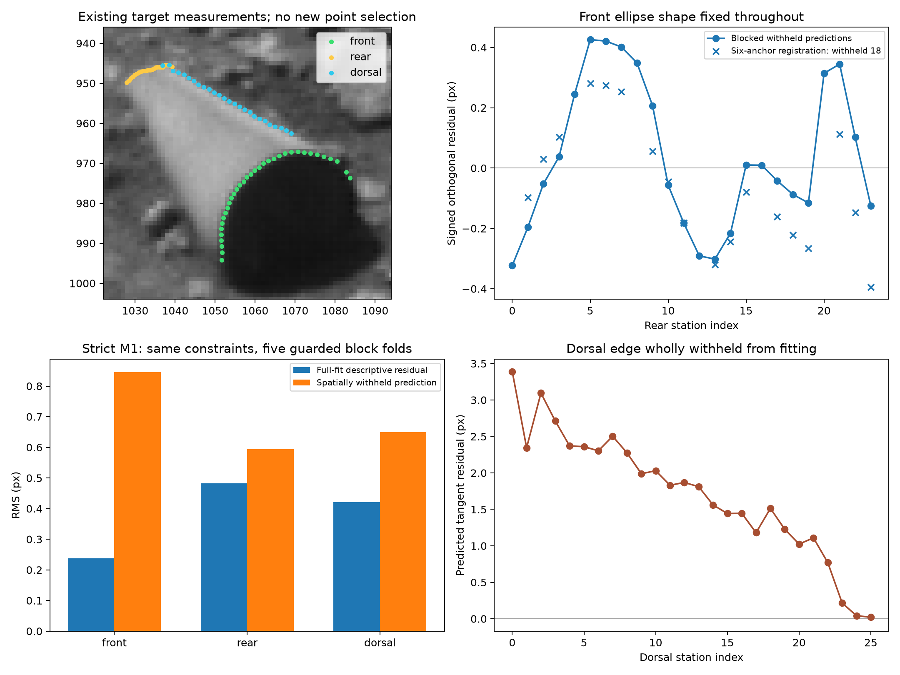

# Predictive geometry validation of the target

These tests use the existing target only. No geological comparison images were added. The protocol was written before the new runs. All outcomes are retained.

## Results

| Check | Scored data | RMS error (px) |
| --- | --- | ---: |
| Established unchanged-front-shape registration, reproduced | All 24 rear stations used for translation fit | 0.1854 |
| Only six rear anchors used for translation | Other 18 rear stations predicted | 0.2084 |
| Five guarded, contiguous rear holdouts | Each rear station predicted once | 0.2429 |
| Strict M1, full fit | All 85 points fitted | 0.3788 |
| Strict M1, five guarded spatial holdouts | Each of 85 points predicted once | 0.7233 |
| Dorsal edge wholly withheld | All 26 dorsal stations predicted from front/rear fits | 1.9092 |

## What these checks establish

The first three checks fix both ellipse axes and its orientation from the existing front/dorsal measurements. The rear data fit two translation coordinates only. In the six-anchor test, the other 18 stations cannot influence registration. In the blocked tests, omitted contiguous points and their two-station guards cannot influence the fitted translation. This quantifies how well transferred front geometry predicts rear points beyond those used to register it.

The strict-cylinder check preserves M1's six parameters, equal end ellipses, collinear centers, and exact dorsal tangency. It refits those parameters to training points only, from three prespecified starting angles. The pooled heldout residuals are: front 0.8456 px, rear 0.5946 px, dorsal 0.6491 px. The withheld scores do not select the optimizer or starting point.

Withholding the entire dorsal feature is a separate cross-feature prediction. It fits only front and rear data, then evaluates M1's required upper tangent with no dorsal offset or angle adjustment. Its result is reported separately from the spatial-block test.

## Assessment of the new evidence

The fixed-shape rear transfer survives both sparse registration and contiguous holdouts with roughly 0.2–0.24 px errors. Thus the rear agreement persists beyond the rear points used to position the copied front ellipse. The six-parameter cylinder also predicts withheld spatial blocks with a pooled error below one pixel, although its error rises from 0.379 px in-sample to 0.723 px out-of-sample.

The whole-dorsal holdout is a separate sensitivity experiment: 1.909 px RMS, maximum 3.391 px. Its front/rear-only optimum has an axis of 33.177 degrees, versus the measured dorsal bearing of 28.895 degrees. These modest absolute deviations exceed the complete-fit residuals and show the information supplied by the measured dorsal constraint: removing it changes the preferred orientation and tangent. This is not a mandatory passing standard, a physical surface-damage measurement, or a calibrated rejection. It is distinct from the fixed-shape rear-transfer tests, which retain dorsal information by design.

All three starting angles converged for every strict-cylinder fit, and no fitted parameter hit the specified bounds. The full-data fit reproduced the original M1 total RMS within 0.00001 px. Training/test membership and complete heldout scoring were checked programmatically.

## Interpretation limits

These are retrospective tests of already selected coordinates from one image. They do not constitute independent image acquisition, redo boundary selection blindly, establish a regional rarity, or measure the probability of manufactured origin. They do directly test predictive geometric consistency beyond the already reported full fit. Registration of an unknown rear position remains explicit; no claim is made to infer cylinder length from a front ellipse alone.

`results.json` retains every fold, fitted parameter, residual, bound-hit diagnostic, and input hash. Reproduce with `python audit/predictive-validation/run_validation.py` using the existing reconstruction environment.
