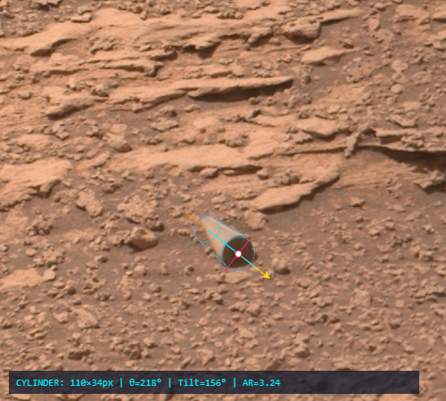

# How AI lowered the barrier to rigorous science, and why it still needs a human who has lived in the world

---

## It started with a picture

In August 2022, NASA's *Curiosity* rover took a photo on Mars. In the lower right corner was something strange. There appeared to be a cylinder poking out of the dirt. It's surrounded by pebbles and dirt, things that one would expect to find on Mars. The object was obviously anomalous.

People noticed. Some said it was debris from the rover. Some said it was just a strange rock. And of course some people immediately jumped to aliens. Even astrophysicist Avi Loeb wrote that NASA should take a closer look.

I'd seen it discussed on podcasts and YouTube videos, but no one ever actually talked about the measurements.

I began this project wanting to determine the actual dimensions and whether or not it was mathematically cylindrical. Numbers seldom lie and rigorous analysis in today's age is relatively simple. However, the temptation to see what you want to see is very real. I can watch a podcast, see a photo someone presents of a "pyramid" or a face, and just because of who I am I am inclined to believe it.

On that note, a disclaimer: I'm not an engineer and I'm not a mathematician. I've never taken a course in computer vision or planetary photogrammetry. However, I am curious and stubborn and probably have too much time on my hands.

I also have a family connection to this work. My great-uncle, Richard "Sam" Bogner, was an engineer at NASA's Jet Propulsion Laboratory. He worked on batteries for Mariner 9, the first spacecraft to orbit Mars, and for the Surveyor lunar landers. I still find myself fascinated by the fact that I share genes with someone who worked on the original Mars missions.

I didn't think I could ever do anything as interesting. It turns out that today, I could do a surprising amount of it, with help.

NASA publishes the raw images from its rovers, along with the metadata. Things like where the camera was pointing, how it was focused, and where the Sun was in the sky. It's all public. Anyone can download it.

---

## What I actually did: Dissecting the data

Before you can ask what something is, you have to find out what it actually measures. Here is what happened when we dug into NASA's raw files:

- **We busted the "20-centimeter" rumor.** Online commentators claimed the object was 20 centimeters long by assuming it was sitting on a distant cliff 45 meters away. But NASA's telemetry logs showed the camera's focus motor count was set to 2705—meaning the lens was focused at exactly **3.96 meters** from the rover. The object isn't on a distant cliff; it's sitting right in front of Curiosity. That dropped its true dimensions to roughly **3.5 centimeters long and 11 millimeters across**—about the diameter of a AA battery.
- **We tested the shadow with solar math.** The mission records showed the Martian Sun was sitting at an elevation of $69.8^\circ$ (nearly straight overhead at noon). At that angle, an object's shadow on the ground must be compressed to just $37\%$ of its physical height. When we measured the shadow fringe beneath the cylinder and compared it to what the Sun's position dictated, it matched to within a fraction of a millimeter. That proved beyond doubt that this is a real, rigid, three-dimensional physical object casting a genuine shadow on the soil, not a digital smudge, a compression defect, or an optical illusion.
- **We pulled the boundaries apart with edge filters.** To keep my eyes from tricking me, I had the AI write code applying spatial "Sobel gradient filters." This math measures how abruptly brightness changes across pixels. It proved that the dark circle on the end wasn't a shadow thrown on the ground, it was the cylinder's own flat, self-shadowed face, completely separate from the neighboring rock and the dirt beneath it.

---

## Building the tool and finding the back edge

Ten years ago, I couldn't have done this analysis because the *tools* were out of reach. Reading NASA's data format, working out camera geometry, writing code for edge detection, fitting ellipses, running the error checks: each of those is a specialty.

AI collapsed that barrier. It wrote the Python code that reads the data format and calculates the center of the image. It explained what a "Sobel filter" is. It did the arithmetic I can't do and the geometry I never learned. When I asked "what does that mean?", it explained, as many times as I needed.

**The barrier to rigorous analysis is lower than it has ever been.**

But here's the part people skip. **The AI got things wrong. Repeatedly.** It was honestly exhausting and at some points infuriating. The things that it couldn't seem to do, even with its ability to do calculus and trigonometry in seconds, were to me, dead simple.

It kept making the same kinds of mistakes:

- **It mixed up two different shadows.** The cylinder's end face is dark because it's turned away from the Sun. That's *its own* shading. Separately, the cylinder throws a shadow on the ground. The software saw "dark stuff" and lumped them together, then built measurements on a shape that didn't exist. I could see, just by looking, that those were two different things.
- **It tried to fit a perfect circle to something that wasn't one.** When you look at a circle from an angle, it becomes an ellipse. The AI kept forcing a circle onto a tilted view. It's the kind of mistake that most intelligent people wouldn't make, mostly because they have spent a lifetime of looking at the world.
- **It swallowed a neighboring rock.** Next to the cylinder was a lump that wasn't part of it. The software kept including it in the outline until I told it to leave that part out.

I finally had the AI build a custom web-based photogrammetry tool that allowed me to overlay a physically accurate 3D cylinder directly onto the NASA photo and manipulate it in real-time. It was as simple as using a mouse wheel to zoom and dragging the mouse to adjust rotation, perspective tilt, and length.

That's when the breakthrough happened:

By dragging the length slider and locking the perspective tilt to match Curiosity's $22^\circ$ downward camera angle, **the back edge of the cylinder lined up with the rock highlight.**

People assumed the cylinder was either a broken stub or a continuous rod plunging indefinitely into the Martian dirt. But the 3D model revealed that the rear cap terminates right where the highlight ends and meets the regolith. It is an exposed, self-contained, discrete cylinder: **110 pixels by 34 pixels**, giving an exact length-to-diameter aspect ratio of **$3.24 : 1$** ($\approx 35\text{ mm} \times 11\text{ mm}$).

Notice what I contributed. It wasn't equations. It was **judgment**. I knew what a shadow looks like. I knew how a cylinder behaves. I knew when something looked wrong even though the math was technically running. The AI had the horsepower. I had the *sense of the world* to tell it when it was pointed in the wrong direction.

---

## Embodied experience still matters

I think this is the most important thing I learned, and I'd like you to take it away from this article.

An AI has read about shadows. I have *stood in* them. It knows the word "perspective." I've driven through a tunnel and seen it. It can describe a coin on a table. I've flipped one and watched the circle become an ellipse.

That lived, physical understanding of how things look and behave is not a small thing. It's what let me notice, quickly and without any formal training, when the analysis had drifted away from reality.

AI can be confidently, fluently wrong. It can produce a clean chart and a convincing explanation of a result that's fundamentally broken. The only reliable defense I found was a human being who has spent years inhabiting a physical world, and who is willing to look at the picture and say, "Wait."

The people who are going to excel moving forward won't be the ones who trust AI the most or the least. They'll be the ones who combine **powerful tools with real-world wisdom** and stay in charge of the process.

---

## Why this actually matters

Why does measuring a tiny 3.5-centimeter object on Mars matter?

1. **It replaces wild speculation with checkable facts.** In an online landscape divided between wild claims ("it's proof of an alien probe!") and lazy dismissal ("it's just a rock, stop looking"), numbers provide sanity. Anyone with a computer and curiosity can download NASA's Sol 3556 dataset, run the equations, and verify the dimensions for themselves. That is how science is supposed to work.
2. **It shows that curiosity doesn't need credentials to be rigorous.** You don't need a PhD or a corporate lab grant to audit space agency data. The data belongs to the public. If you are willing to learn, ask hard questions, and refuse to accept comfortable assumptions, you can do genuine planetary forensics from your living room.
3. **It demonstrates the future of human-AI collaboration.** AI isn't an oracle that hands down absolute truth, nor is it a useless novelty. It's an exoskeleton for human curiosity. When guided by someone who refuses to let it hallucinate, it allows one person to do the work that once required an entire research team.

---

## You can do this too

NASA's rover images are public. So are images from the Hubble and James Webb telescopes, satellite archives, weather data, seismic logs, and thousands of other datasets. For most of history, serious investigation required a university, a lab, and a funding source. Now it requires **curiosity, patience, and a willingness to be corrected.**

If you're thinking about trying something like this, here's what I'd suggest:

1. **Start with a question you can actually answer.** Not "is this alien?" but "how big is this, really?" Small, measurable questions lead somewhere.
2. **Use the original data, not screenshots.** Compressed social media images throw away exactly the information you need.
3. **Let AI do the heavy lifting, but never the thinking.** Ask it to explain everything. Ask it to show its work. Ask "how would I know if this were wrong?"
4. **Trust your eyes and your instincts.** If a result looks off, make the software justify itself.
5. **Be honest about what you don't know.** The most credible sentence in my paper is the one that says that I don't know what the object is.
6. **Share your work openly.** Let other people check it, argue with it, and break it. That's how science works.

---

## What happens next

I still don't know what that object is. But now I know that it's actually cylindrical. And I know that it shouldn't be there.

It could be something from the rover's own history that we haven't traced. It could be an extraordinary geological anomaly unlike anything we've catalogued. It could be something stranger. The honest answer is that the analysis narrows the possibilities, and a close-up look from Curiosity's contact instruments—like the MAHLI hand lens or the ChemCam spectrometer—would do far more than any amount of image processing from Earth. That's what Avi Loeb asked for, and I agree with him.

When I say "something stranger," I mean something that most mainstream planetary science is hesitant to say out loud, but that every curious person wonders about in the quiet of their thoughts: could Mars have once hosted an ancient technological presence? If I am being completely candid about what drives my imagination, the spark of curiosity that kept me up late staring at pixel grids, I sincerely hope that this cylinder might turn out to be evidence of that.

Theoretical plasma physicist Dr. John Brandenburg pointed to isotopic Xenon-129 anomalies on Mars. Penn State astrophysicist Dr. Jason Wright published papers detailing how durable non-biological artifacts (technosignatures) could survive buried in planetary soil for billions of years. When I look at this clean cylinder with its flat circular end face, I think about those models.

**Do I know that's what it is? Absolutely not.**

And that honesty is what keeps this work credible. The math does not prove an ancient artifact; it only proves that the object is small, physically real, precisely shaped ($3.5\,\text{cm} \times 1.1\,\text{cm}$), and unaccounted for by conventional optical glitches or known rover shedding.

The point isn't to jump to conclusions. The point is that *we are allowed to look, we are allowed to wonder, and we are allowed to measure.*

Whatever the answer turns out to be, something has already changed. A person with no engineering degree and no math training was able to sit down with public data and produce a careful, checkable, honest analysis.

The sky is full of data. The tools are in reach. What it still needs is people willing to look carefully, ask honest questions, and use their own eyes and judgment to steer
---

*The accompanying technical paper, "Morphological and Photometric Analysis of an Unidentified Cylindrical Feature in Curiosity Sol 3556 Mastcam Imagery," contains the complete methods, equations, and figures for anyone who wants to check the work, or improve on it.*
