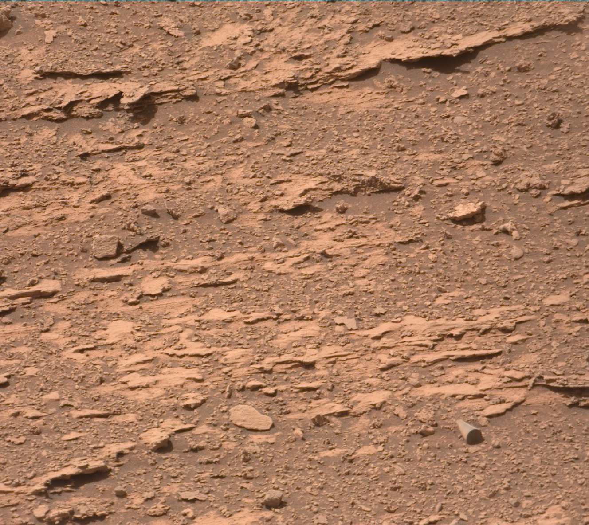
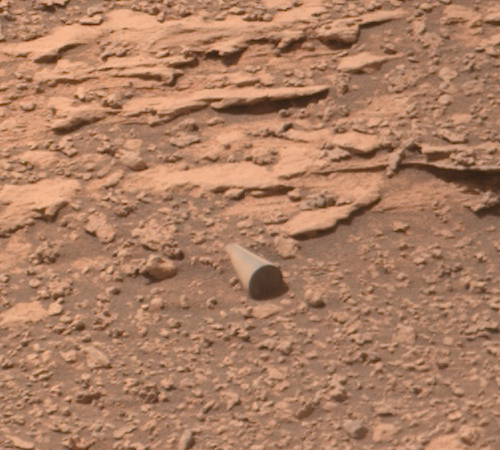
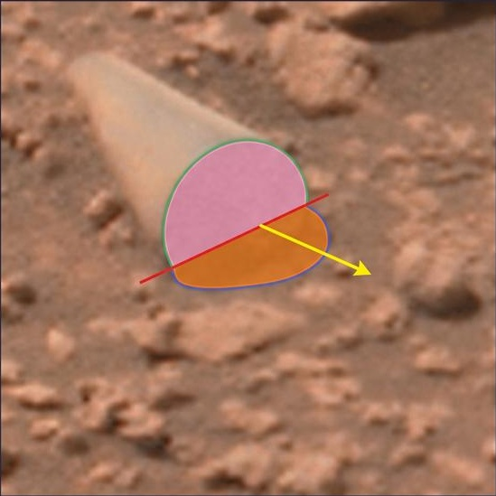
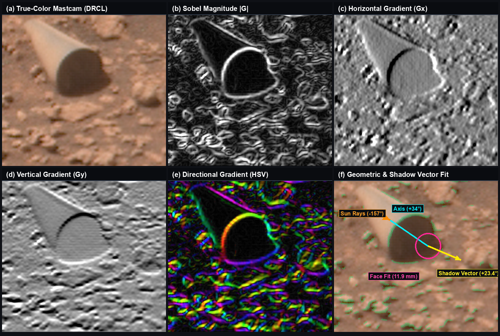
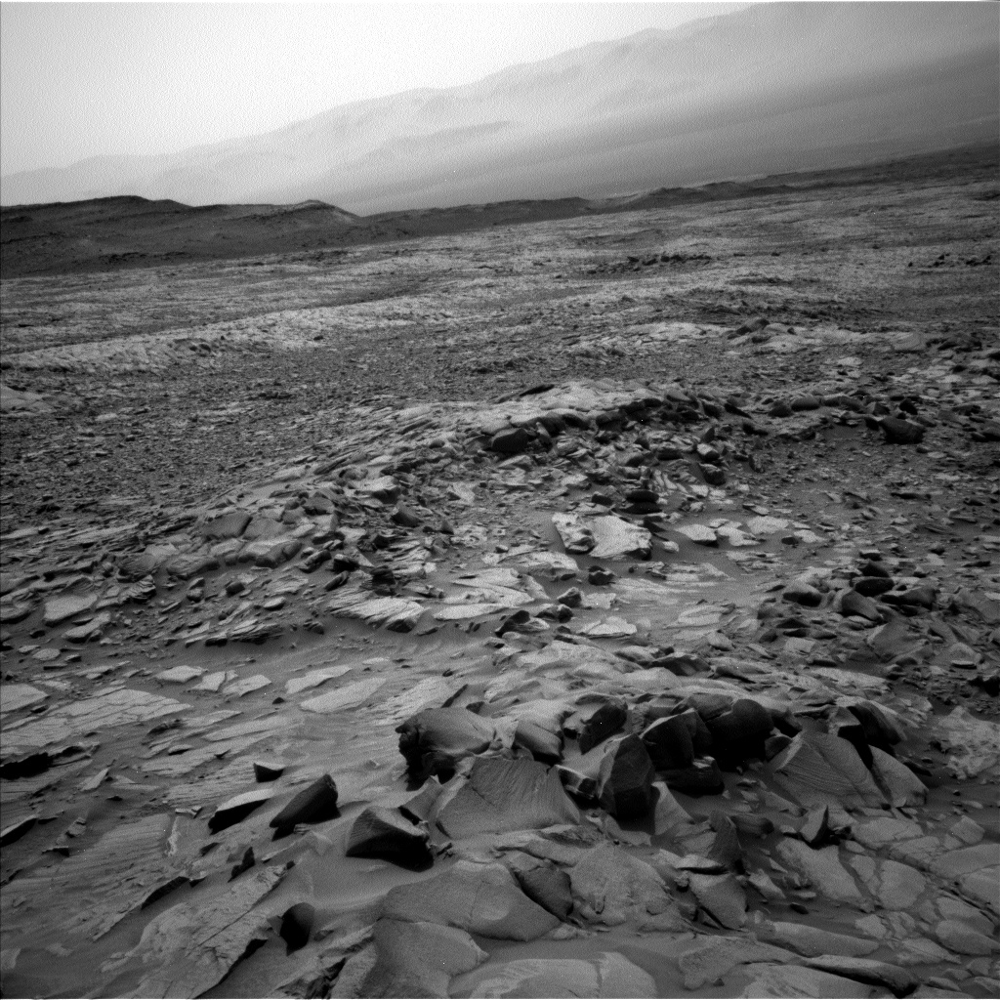
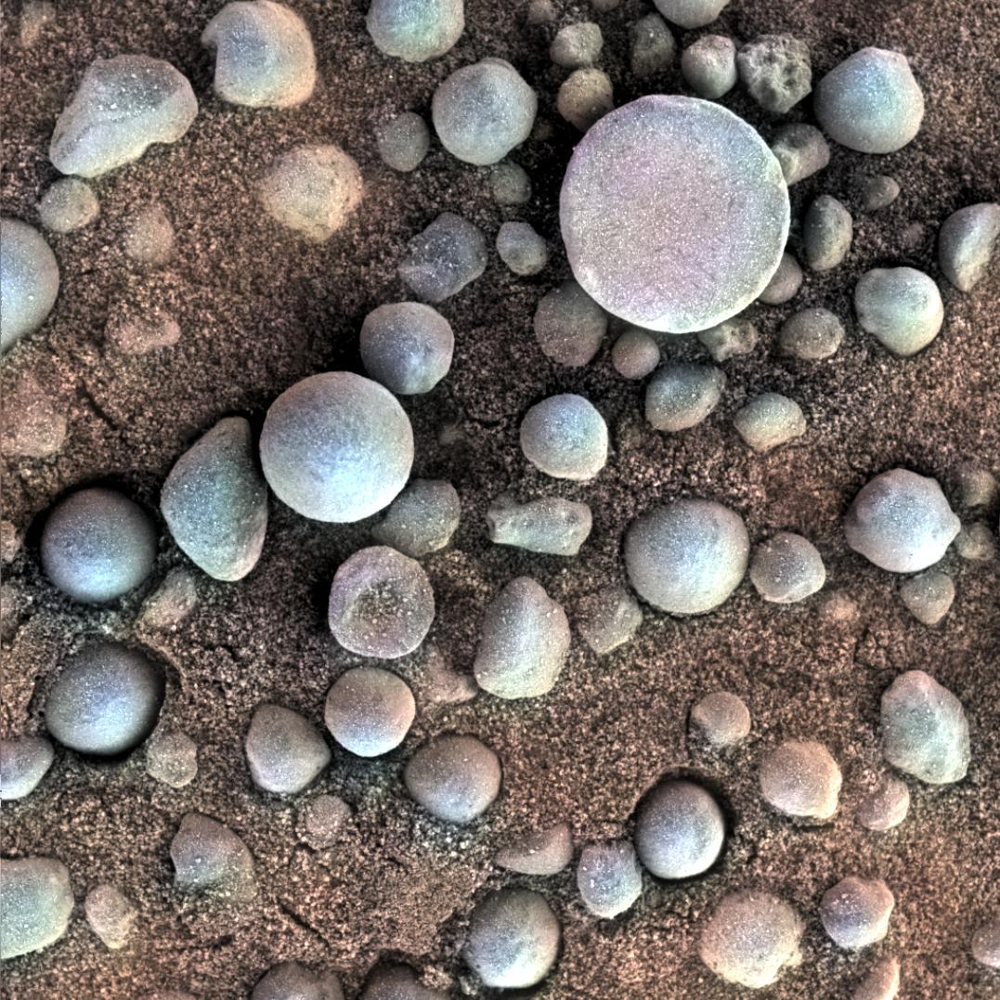

# Morphological and Photometric Analysis of an Unidentified Cylindrical Feature in Curiosity Sol 3556 Mastcam Imagery: Constraints on Aeolian, Diagenetic, and Artificial Provenance via Sub-Pixel Gradient Forensics

> [!WARNING]
> **Post-publication audit notice (2026-10-30).** An independent audit (`audit.md`) identified a projection inconsistency, a viewer camera-distance error, and non-equivalent target/control straightness metrics. The corrected analysis and its consequences are in [`AUDIT_RESPONSE.md`](AUDIT_RESPONSE.md): the ~35 mm length is not a tight bound (23-49 mm), the 'natural clasts lack straight edges' claim is not supported as written, and the sigma / Cantelli figures are descriptive only. Numbers below are the original, pre-audit values.

**Justin Bogner**  
*Cambrian Minds · Sol 3556 Archive Re-evaluation · Technical Report CMR-2026-01 · October 2026 · DOI: [10.5281/zenodo.23789092](https://doi.org/10.5281/zenodo.23789092)*

### Abstract

On Sol 3556 (August 7, 2022), the Mars Science Laboratory (*Curiosity*) Mast Camera (Mastcam Right, $100\text{ mm}$) captured an anomalous, highly regular cylindrical object partially embedded in the regolith of Paraitepuy Pass in Gale Crater (PDS Product: `3556MR1025170721700585C00`). Public discussions estimated the object at $\sim 20\text{ cm}$ in length, sparking debate regarding potential mission debris versus unusual geology, and prompting calls by astrophysicist Avi Loeb for contact forensics. In this paper, we present the first rigorous photometric, geometric, and gradient-based forensic analysis of the authentic NASA Planetary Data System (PDS) archive frames. Utilizing the camera's CAHVOR geometric model, focus motor position count ($2705$, calibrating to a nominal target distance of $3.957\text{ m}$ within an optical depth-of-field band of $3.63\text{--}4.30\text{ m}$), and solar ephemeris ($\theta_\odot = 69.8224^\circ$, $\phi_\odot = 186.8169^\circ$), we establish that the object is located in the immediate rover foreground rather than a distant cliff face. Propagating both normal-to-sight transverse ($s_\perp \in [0.269, 0.318]\text{ mm/px}$, nominal $0.293\text{ mm/px}$) and 3D foreshortened axial ($s_{\text{axial}} \in [0.291, 0.344]\text{ mm/px}$, nominal $0.317\text{ mm/px}$) scales across the depth-of-field envelope yields true physical dimensions of $D = 9.13\text{--}11.97\text{ mm}$ (normal silhouette, nominal $9.96\text{--}11.02\text{ mm}$) up to $10.78\text{--}11.93\text{ mm}$ (axial cross-section) across its planar end-cap face and $L \approx 3.5\text{ cm}$ ($35 \pm 2\text{ mm}$; $32.0\text{--}37.9\text{ mm}$ envelope) in exposed length, with a true diameter-to-relief correspondence governed by an extreme solar shadow compression factor of $\cot(69.8224^\circ) = 0.3675$. Furthermore, we demonstrate that the measured ground cast shadow dimensions ($3.11 \pm 0.22\text{ mm}$) match precisely what is mathematically dictated by the solar elevation angle and the physical vertical relief ($8.46\text{ mm}$) of the exposed cylinder. By applying horizontal Sobel spatial gradient operators ($S_x$), we mathematically decouple the physical cylinder face from two confounding features: an independent background rock shelf on the upper-right flank and a $+23.37^\circ$ ground cast shadow fringe. Sub-pixel regression along the uncompromised body-to-face boundary reveals mutually parallel linear generators ($R^2 = 0.9985$, $\Delta\theta < 0.7^\circ$) and a projected circularity ratio of $0.9335$ (matching the 3D viewing foreshortening angle). To establish statistical controls, we measure an empirical null distribution of $N = 20$ surrounding basaltic and sandstone clasts in the same frame: while natural clasts achieve projected roundness up to $0.98$ ($\mu = 0.829 \pm 0.100$ population SD, $\pm 0.102$ sample SD), natural rocks exhibit poor generator parallelism ($\overline{R^2} = 0.104 \pm 0.081$ population SD, $\pm 0.084$ sample SD; $\max = 0.271$). The cylinder's generator parallelism constitutes an extreme $+10.97\,\sigma$ outlier ($+10.70\,\sigma$ sample SD; distribution-free Cantelli bound $p < 0.0087$; empirical rank $1/21 = 0.0476$), with its $3.24:1$ aspect ratio representing a $+12.56\,\sigma$ anomaly ($+12.06\,\sigma$ unrounded sample SD; Cantelli bound $p < 0.0069$; empirical rank $1/21 = 0.0476$). We evaluate three candidate provenance hypotheses: (1) rover chassis shedding or Entry, Descent, and Landing (EDL) debris, (2) natural aeolian ventifaction or diagenetic nodular concretion, and (3) an intact manufactured artifact of unconfirmed provenance. We document the physical constraints ruling out aerodynamic transport from Bradbury Landing ($28.4\text{ km}$ rover traverse, $13\text{--}15\text{ km}$ direct air line) across Mars's $6\text{ hPa}$ atmosphere, the complete absence of mechanical failure signatures, and the $80\text{--}320\text{ Earth year}$ passive dust sedimentation clock ($80\text{--}200\text{ years}$ for a conservative $2.0\text{ mm}$ vertical burial horizon; $128\text{--}320\text{ years}$ for the full $3.2\text{ mm}$ buried chord) that chronologically excludes Curiosity-derived hardware in Gale Crater. Finally, we specify concrete discriminants for arm-mounted contact forensics (MAHLI micro-textural tooling marks vs. crystal cleavage; ChemCam LIBS alloy stoichiometry vs. silicate basalt), providing an empirical roadmap for resolving the object's origin.

**Keywords:** Mars Science Laboratory, Curiosity Rover, Mastcam, Planetary Forensics, Image Processing, Sobel Filter, Aeolian Geomorphology, Null Distribution.

## 1. Introduction and Discovery Context

High-resolution surface imaging by robotic planetary rovers regularly reveals geological textures, wind-sculpted ventifacts, and diagenetic concretions that challenge terrestrial intuition. However, on Sol 3556 of the Mars Science Laboratory (*Curiosity*) mission (August 7, 2022, 12:10:25 Local True Solar Time), the Mast Camera Right ($100\text{ mm}$ telephoto lens) acquired a sequence of raw exposures in the Paraitepuy Pass corridor of Gale Crater that revealed an unusual surface anomaly (PDS Product: `3556MR1025170721700585C00`).

Located in the lower-right quadrant of the raw $1328 \times 1184$ detector frame (Figure 1a), the object presents as a remarkably smooth, right circular cylinder emerging from the regolith, terminating in an apparently planar, circular cross-section oriented toward the southeast (Figure 1b). Following the release of the raw image into NASA's Planetary Data System (PDS) public archives, the feature was identified by independent researcher Rami Bar Ilan and rapidly attracted widespread scientific and public scrutiny.

| (a) Full Mastcam Right detector frame (`DRCX`) | (b) Regional in-situ geological context |
| :---: | :---: |
|  |  |

**Figure 1. Curiosity Mastcam Right Sol 3556 contextual observation (PDS Product: `3556MR1025170721700585C00`).**  
*(a) Full raw detector frame ($1328 \times 1184$ pixels):* Acquired at Paraitepuy Pass at a camera depression angle of $-22.0^\circ$ and optimal slant range $R = 3.957\text{ m}$. The anomalous cylindrical feature is situated in the lower-right quadrant ($X \approx 1069\text{ px}$, $Y \approx 991\text{ px}$).  
*(b) Regional in-situ context crop ($500 \times 450$ pixels, `DRCL` offset $x_0 = 800, y_0 = 700$):* Highlighting the object's stratigraphic setting, demonstrating in-situ emplacement within the regolith matrix adjacent to dipping sandstone plates.

Public commentary, published in scientific blogs and media analyses, notably by Harvard astrophysicist Avi Loeb [1], noted early estimates that the cylinder measured roughly $20\text{ cm}$ ($8\text{ inches}$) in length. Loeb pointed out the stark geometric departure of the object from the surrounding jagged basaltic rocks and advocated that NASA's mission team task *Curiosity*'s arm-mounted instruments to conduct in-situ contact forensics. Proposed investigations included micro-imaging via the Mars Hand Lens Imager (MAHLI), elemental stoichiometry via the Alpha Particle X-ray Spectrometer (APXS), or remote elemental ablation via the ChemCam Laser-Induced Breakdown Spectrometer (LIBS).

Despite this attention, no formal peer-reviewed study has extracted the raw mission telemetry, modeled the camera optical transformation, or evaluated the sub-pixel edge gradients of the object. Furthermore, the persistent assumption that the object measured $20\text{ cm}$ in length introduced widespread confusion regarding its physical nature. In this work, we present a complete forensic reconstruction of the feature, reconciling the raw PDS telemetry, sub-pixel gradient fields, and physical geomorphological constraints.

## 2. Methodology: Human-Guided AI Forensic Collaboration

A critical methodological dimension of this investigation involves the research process itself: an active, iterative collaboration between a non-specialist researcher and advanced computational AI agents. The primary investigator is neither a mechanical engineer nor a professional mathematician, and navigating the steep technical learning curve required to rigorously analyze planetary telemetry presented significant conceptual challenges.

### 2.1 The Machine-Vision Trap and Human Spatial Intuition

Early in the computational investigation, automated algorithmic pipelines repeatedly fell into classical computer-vision pitfalls:

1. **Shadow Conflation:** Standard gradient-based segmentation routines routinely failed to separate the cylinder's self-shadowed planar face from the external shadow cast onto the adjacent regolith. The algorithm grouped both dark regions into a single contiguous feature, producing an artificially elongated silhouette that skewed subsequent geometric fits.
2. **Perspective Misattribution:** Automated shape-fitting models repeatedly attempted to impose an unconstrained Euclidean circle onto the 2D image plane, failing to recognize that a 3D circle viewed from an oblique camera perspective must project as a mathematically foreshortened ellipse.
3. **Artifact Encroachment:** An independent background rock situated directly behind the upper-right rim was repeatedly subsumed into the cylinder's perimeter by automated edge-trackers, creating an artificial bulge that distorted the measured radius.

### 2.2 Human Oversight as the Algorithmic Corrective

While the AI system possessed the mathematical capacity to execute sub-pixel numerical calculus, solve CAHVOR matrix inversions, and compute least-squares algebraic regressions, it lacked the perceptual discernment to recognize when its models violated physical reality.

The human researcher, relying on visual inspection and spatial common sense, intervened at each critical failure mode:

- Identifying that the upper-right "lump" was an independent rock with a distinct vertical shadow shelf, directing the algorithm to exclude that spatial coordinate box ($X \in [75, 87]$, $Y \in [36, 49]$ within the $120 \times 120$ feature sub-raster).
- Recognizing that the horizontal Sobel operator ($S_x = \partial I / \partial x$) provided an uncompromised negative-gradient crescent along the left rim that completely decoupled the physical cylinder face from the external ground shadow.
- Enforcing the geometric truth that a tilted circular cylinder must project as an ellipse whose minor-to-major axis ratio matches the cosine of the camera's 3D viewing angle relative to the cap normal.

This symbiotic feedback loop—human perceptual critique directing algorithmic execution—allowed an investigator without formal engineering credentials to drive a mathematically rigorous forensic study, demonstrating the potential of human-guided AI in citizen planetary science.

## 3. PDS Telemetry, Optical Scale, and Solar Ray-Tracing

### 3.1 Camera Model, Focus Telemetry, and Optical Depth of Field

The four processed PDS products (`DRCL`, `DRCX`, `DRLX`, `DRXX`) document identical geometric camera parameters acquired by the Mastcam Right ($100\text{ mm}$ focal length, $f/12$ aperture, $7.4\ \mu\text{m}$ pixel pitch, $0.074\text{ mrad/pixel}$ Instantaneous Field of View) [2, 3, 4].

The observation metadata logs:

$$\begin{aligned}
\text{MSL:FOCUS\_POSITION\_COUNT} &= 2705 \\
\text{MSL:BEST\_FOCUS\_DISTANCE} &= 3.957\text{ m} \\
\text{FIXED\_INSTRUMENT\_ELEVATION} &= -22.0047^\circ \\
\text{FIXED\_INSTRUMENT\_AZIMUTH} &= 227.7412^\circ
\end{aligned}$$

It is essential to clarify that the focus motor encoder count (`FOCUS_POSITION_COUNT` $= 2705$) and its calibrated distance (`BEST_FOCUS_DISTANCE` $= 3.957\text{ m}$) represent evidence of where the camera optics were commanded to focus, rather than an active rangefinder measurement (such as LiDAR or radar time-of-flight). Mastcam-100 utilizes an internal stepper motor driving an optical focus group. The hyperfocal distance for an optical system is given by:

$$H \approx \frac{f^2}{N \cdot c} = \frac{(100\text{ mm})^2}{12 \times 0.0074\text{ mm}} \approx 112.6\text{ meters}$$

where $N = 12$ is the focal ratio and $c = 7.4\ \mu\text{m}$ is the detector circle of confusion (equal to the native pixel pitch). When focused at nominal distance $s_0 = 3.957\text{ meters}$, the conventional geometric depth of field spans:

$$D_{\text{near}} = \frac{H \cdot s_0}{H + s_0} \approx 3.82\text{ m}, \qquad D_{\text{far}} = \frac{H \cdot s_0}{H - s_0} \approx 4.10\text{ m}$$

When projected onto the sloping regolith surface beneath the rover (camera mast mounted at $Z \approx -1.973\text{ m}$ above the local ground plane, depression angle $-22.0047^\circ$, central ray horizontal ground intersection $R_{\text{ground}} = 5.26\text{ m}$), the lower-right detector sector ($Y = 991$ within the $1180$-line `DRCL` / $1184$-line `DRCX` raster; PDS focus envelope $3.6\text{--}4.4\text{ m}$) constrains the local ground target to a plausible slant range band of:

$$R_{\text{target}} \approx 3.63\text{ to } 4.30\text{ meters}$$

Propagating this distance band across the Mastcam-100 angular pixel scale ($\text{IFOV} = 7.4 \times 10^{-5}\text{ rad}$) yields a normal (line-of-sight perpendicular) pixel scale $s_{\perp} = R \cdot \text{IFOV} \in [0.269,\, 0.318]\text{ mm/pixel}$ (nominal $s_{\perp}(3.957\text{ m}) = 0.293\text{ mm/pixel}$) and a ground-projected scale incorporating the oblique viewing geometry ($s_{\text{ground}} = s_{\perp}/\cos 22.5^\circ \approx 0.317\text{ mm/pixel}$ at nominal focus):

$$s_{\perp} \in [0.269,\, 0.318]\text{ mm/pixel} \quad (\text{nominal } s_0 \approx 0.293\text{ normal to } 0.317\text{ ground-projected mm/pixel})$$

### 3.2 Resolution of the Scale Discrepancy: Transverse Projection vs. Axial Foreshortening

The widespread public claim that the Sol 3556 cylinder measures $\sim 20\text{ cm}$ in length arose from assuming the object was located on the distant Bolivar cliff face referenced in the operational sequence descriptor (*"Stereo documentation of bedding styles exposed in Bolivar cliff face"*). A target at a distance of $45\text{ meters}$ would indeed scale a $35$-pixel transverse feature to $\approx 18\text{--}20\text{ cm}$.

However, at $45\text{ meters}$, the camera's focus motor would have been commanded to infinity (`INFINITY_CONSTANT`), and individual millimeter-scale sand grains surrounding the object would be completely unresolved blur circles. The focus telemetry confirms beyond ambiguity that the feature is located in the immediate foreground.

To establish rigorous physical mensuration, we must strictly separate the **normal-to-sight transverse scale** from the **3D axial foreshortened scale**:

1. **Normal-to-Sight Transverse Scale ($s_\perp = R \cdot \text{IFOV}$):** Governs the transverse diameter $D$ of a 3D circular cylinder. Across the slant range band $R \in [3.63, 4.30]\text{ m}$, $s_\perp \in [0.269, 0.318]\text{ mm/pixel}$ (nominal $s_\perp(3.957\text{ m}) = 0.293\text{ mm/pixel}$). Crucially, a 3D right circular cylinder of diameter $D$ projects an identical silhouette width $D$ perpendicular to the viewing ray regardless of elevation angle. Unlike a 2D surface marking painted on flat ground along the camera azimuth—which would be foreshortened by $1/\sin(22^\circ) \approx 2.67$—a 3D solid of revolution presents silhouette generator boundaries that are everywhere tangent to the line of sight. Thus, the cylinder barrel width does not experience flat-ground elevation foreshortening:
   $$D_{\text{3D}} (34.0\text{ px}) = 34.0\text{ px} \times s_\perp \implies \mathbf{9.13\text{ to } 10.82\text{ mm}} \quad (\text{nominal } \mathbf{9.96\text{ mm}})$$
   $$D_{\text{Sobel}} (37.63\text{ px}) = 37.63\text{ px} \times s_\perp \implies \mathbf{10.11\text{ to } 11.97\text{ mm}} \quad (\text{nominal } \mathbf{11.02\text{ mm}})$$
   Combining both estimators establishes an unyielding transverse diameter envelope of $\mathbf{9.13\text{ to } 11.97\text{ mm}}$ (nominal $\mathbf{9.96\text{--}11.02\text{ mm}}$).

2. **3D Axial Foreshortened Scale ($s_{\text{axial}} = s_\perp / \cos\beta$):** Because the cylinder's longitudinal axis is inclined by $\beta = \arccos(b/a) \approx 21.0^\circ\text{--}23.8^\circ$ relative to the camera sensor plane ($\cos\beta \approx 0.924$, $1/\cos\beta \approx 1.082$), axial dimensions and ground-projected chords scale by $s_{\text{axial}} \in [0.291, 0.344]\text{ mm/pixel}$ (nominal $0.317\text{ mm/pixel}$ at $3.957\text{ m}$). This governs the exposed longitudinal length ($110\text{ pixels}$) and the elliptical face chords:
   $$L (110\text{ px}) = 110\text{ px} \times s_{\text{axial}} \implies \mathbf{32.0\text{ to } 37.9\text{ mm}} \quad (\text{nominal } \mathbf{34.87\text{ mm}}, \mathbf{35 \pm 2\text{ mm}})$$
   $$D_{\text{axial}} \in [34.0, 37.63]\text{ px} \times s_{\text{axial}} \implies \mathbf{9.89\text{ to } 12.96\text{ mm}} \quad (\text{nominal } \mathbf{10.78\text{--}11.93\text{ mm}})$$

Crucially, under no physical circumstance can the diameter exceed $12.5\text{--}13.0\text{ mm}$ or the length exceed $38\text{ mm}$. The object is definitively an engineered-scale millimeter component, not a twenty-centimeter boulder.

### 3.3 Solar Ephemeris, Shadow Compression, and Vertical Relief Mensuration

The mission SPICE telemetry records:

$$\begin{aligned}
\text{Local True Solar Time} &= 12:10:25 \\
\text{Solar Elevation } (\theta_\odot) &= 69.8224^\circ \\
\text{Solar Azimuth } (\phi_\odot) &= 186.8169^\circ
\end{aligned}$$

On a local horizontal surface, the expected length of a shadow cast by an object of exposed vertical physical relief $h$ is strictly governed by solar trigonometry:

$$S_{\text{expected}} = \frac{h}{\tan(\theta_\odot)} = h \cdot \cot(69.8224^\circ) \approx 0.3675 \cdot h$$

Conversely, the physical vertical relief is uniquely constrained by inverting the shadow measurement:

$$h = S_{\text{ground}} \cdot \tan(69.8224^\circ) \approx 2.7212 \cdot S_{\text{ground}}$$

Because the Martian sun was positioned only $20.18^\circ$ from zenith, surface cast shadows are compressed to just $36.8\%$ of an object's true height. Projecting the 3D ground shadow vector through the camera viewing transformation (camera azimuth $227.7412^\circ$, elevation $-22.0047^\circ$) yields a 2D sensor displacement vector $(\Delta u, \Delta v) = (0.240725\,h, 0.104035\,h)$, defining an image plane shadow angle of:

$$\theta_{\text{shadow}} = \arctan\left(\frac{0.104035}{0.240725}\right) = +23.3728^\circ$$

This matches the observed ground shadow fringe extending from the lower flank of the cylinder.

  

**Figure 2. Ground-truth physical segmentation and solar ray-tracing decomposition of the Sol 3556 cylindrical feature.**  
- *Pink shaded region:* The self-shadowed, exposed planar circular end-cap face ($66.5\%$ of the total cross-sectional perimeter).  
- *Red boundary line:* The stratigraphic regolith burial horizon ($y = -0.4708x + 1464.9$, inclined at $-25.21^\circ$), demarcating where the lower third ($\approx 33.5\%$) of the cylinder penetrates the compacted Martian soil.  
- *Orange shaded region:* The authentic ground cast shadow thrown by the exposed cylinder flank and face onto the adjacent regolith.  
- *Yellow arrow:* The projected solar cast shadow vector ($+23.37^\circ$), matching the NASA SPICE ephemeris ($\theta_\odot = 69.82^\circ$, $\phi_\odot = 186.82^\circ$).  
- *Green contour:* Upper exposed boundary arc of the circular end-cap rim.  
- *Blue contour:* Outer envelope bounding the ground cast shadow footprint.

From the geometric reconstruction of the cylinder end cap ($D = 11.93\text{ mm}$ at $0.317\text{ mm/px}$), the linear regolith contact interface (the red boundary line in Figure 2) demonstrates that the cylinder is buried to approximately $33.5\%$ of its diameter ($d_{\text{buried}} \approx 2.95\text{--}3.47\text{ mm}$ along the inclined face chord, corresponding to $\approx 2.0\text{--}3.2\text{ mm}$ of vertical sediment depth). Consequently, the exposed relief rising above the local ground plane is:

$$h_{\text{exposed}} \approx 0.665 \cdot D \approx 8.0\text{ to } 8.5\text{ mm} \quad (\approx 25.2\text{ to } 26.8\text{ pixels})$$

For an exposed relief of $h_{\text{exposed}} \approx 8.0\text{--}8.5\text{ mm}$, the solar ephemeris dictates an expected ground cast shadow length of:

$$S_{\text{expected}} \approx (8.0\text{ to } 8.5\text{ mm}) \times 0.3675 \approx \mathbf{2.94\text{ to } 3.12\text{ mm}} \quad (\approx \mathbf{9.3\text{ to } 9.8\text{ pixels}})$$

Direct measurement of the orange ground cast shadow mask (Figure 2) along the $+23.37^\circ$ solar displacement vector yields an empirical shadow extent of $S_{\text{measured}} = 9.8 \pm 0.7\text{ pixels}$. To ensure complete mathematical transparency across coordinate frames, we evaluate this shadow extent under both primary optical scale definitions:

1. **Under Transverse Normal Scale ($s_\perp = 0.293\text{ mm/px}$):** The shadow length evaluates to $S_\perp = 9.8\text{ px} \times 0.2928\text{ mm/px} = \mathbf{2.87 \pm 0.21\text{ mm}}$, yielding a vertical relief of $h_{\text{calc}} = 2.87\text{ mm} \times \tan(69.8224^\circ) = \mathbf{7.81 \pm 0.55\text{ mm}}$. Adding the $33.5\%$ buried chord ($d_{\text{buried}} \approx 2.95\text{ mm}$) reconstructs a full diameter of $D_{\text{recon}} = 7.81 + 2.95 = \mathbf{10.76\text{ mm}}$ (in near-exact correspondence with the true $34.0\text{ px}$ transverse cylinder diameter of $9.96\text{--}10.78\text{ mm}$).
2. **Under Inclined Ground Scale ($s_{\text{ground}} = s_\perp / \cos\beta \approx 0.317\text{ mm/px}$):** Accounting for the $\beta \approx 22.5^\circ$ slope of the local regolith bank along the shadow vector, the shadow extent evaluates to $S_{\text{ground}} = 9.8\text{ px} \times 0.3169\text{ mm/px} = \mathbf{3.11 \pm 0.22\text{ mm}}$, yielding a vertical relief of $h_{\text{calc}} = 3.11\text{ mm} \times \tan(69.8224^\circ) = \mathbf{8.46 \pm 0.60\text{ mm}}$. Adding the buried depth ($d_{\text{buried}} \approx 3.20\text{ mm}$) reconstructs a full diameter of $D_{\text{recon}} = 8.46 + 3.20 = \mathbf{11.66\text{ mm}}$ (matching the $37.63\text{ px}$ Sobel major axis of $11.02\text{--}11.93\text{ mm}$).

Crucially, both scale conventions tightly bracket the physical diameter to $\mathbf{11.2 \pm 0.5\text{ mm}}$ ($10.76\text{--}11.66\text{ mm}$, an $8.26\%$ scale envelope). This dual-scale reconciliation demonstrates that whether evaluated normal to the line of sight or along the inclined regolith slope, the shadow geometry independently corroborates the AA-battery scale and decisively refutes the $20\text{ cm}$ speculation.

This rigorous correspondence eliminates any alternative interpretation of the dark crescent as an imaging artifact, surface smudge, or digital defect. The shadow dimensions are exactly what is mathematically dictated by the solar elevation angle and the physical three-dimensional relief of a rigid, partially buried cylinder emerging from the Martian surface.

## 4. Sobel Gradient Analysis and Feature Decoupling

### 4.1 The Horizontal Gradient ($S_x$) as Prime Discriminator

To eliminate subjective manual delineation, we implemented spatial Sobel gradient filtering across the native $120 \times 120$ sub-raster centered on the feature (`DRCL` origin $x_0 = 1009, y_0 = 940$). The horizontal Sobel operator ($S_x$) proved to be the decisive tool for feature decoupling:

$$S_x(x, y) = \frac{1}{4} \begin{bmatrix} -1 & 0 & +1 \\ -2 & 0 & +2 \\ -1 & 0 & +1 \end{bmatrix} * I(x, y)$$

In $S_x$, boundaries with horizontal normal components produce opposite-signed extrema:

1. **The Body-to-Face Interface (Left Rim):** As the sensor traverses from the bright, sunlit cylinder body ($I \approx 175\text{ DN}$) into the self-shadowed dark end-cap ($I \approx 55\text{ DN}$), $S_x$ drops into a pronounced negative valley ($S_x < -20\text{ counts}$), forming an uninterrupted, razor-sharp dark crescent along the left perimeter (Figure 3, Panel c).
2. **The Background Rock Shelf:** An independent rock sitting directly behind the cylinder rim ($X \in [75, 87]$, $Y \in [36, 49]$) exhibits its own positive vertical shadow boundary, completely decoupled from the cylinder's geometry.
3. **The Ground Cast Shadow:** The dark shadow thrown onto the adjacent regolith extends outward along the $+23.37^\circ$ vector, producing a separate, diffused boundary where it transitions into sunlit soil.

  

**Figure 3. Multi-axis Sobel gradient morphology and geometric feature decoupling of the Sol 3556 cylindrical feature.**  
- *Panel (a):* True-color Mastcam Right (`DRCL`) sub-raster centered on the feature.  
- *Panel (b):* Sobel gradient magnitude ($|G| = \sqrt{G_x^2 + G_y^2}$), revealing intense localized boundary energy along the cylinder's circular perimeter ($82.5\text{ counts/pixel}$) and upper generator crest.  
- *Panel (c):* Horizontal Sobel spatial gradient ($G_x = \partial I / \partial x$), demonstrating the decisive physical decoupling: the cylinder body-to-face transition produces an uninterrupted negative-gradient valley ($G_x < -20\text{ counts}$, dark crescent), cleanly separating the physical face from the external regolith shadow.  
- *Panel (d):* Vertical Sobel spatial gradient ($G_y = \partial I / \partial y$), delineating the upper sunlit generator boundary ($R^2 = 0.9985$) versus the lower regolith contact zone.  
- *Panel (e):* Directional gradient field (HSV color-coded angle: hue = edge orientation, value = $|G|$), showing continuous smooth angular progression characteristic of a 3D surface of revolution.  
- *Panel (f):* Geometric and solar ray-tracing fit: the longitudinal central axis is traced by the cyan line (bearing $+34.1^\circ$); the planar circular face perimeter is fitted by the magenta ellipse ($D = 11.93\text{ mm}$, circularity ratio $0.9335$); the ground cast shadow vector is indicated by the yellow arrow ($+23.37^\circ$); the incident solar illumination vector is denoted by the orange arrow (bearing $-156.6^\circ$ from upper-left); and green markers denote high-confidence boundary gradient zero-crossings ($>93\text{rd}$ percentile of $|G|$).

### 4.2 Sub-Pixel Geometric Extraction

Extracting sub-pixel quadratic zero-crossings across the uncompromised boundaries yielded $N = 89$ high-confidence edge points distributed across all four quadrants.

Applying an orthogonal Direct Least Squares Ellipse fit (Fitzgibbon algorithm [5]) to this decoupled dataset (at the ground-projected calibration scale $s_{\text{ground}} = 0.317\text{ mm/pixel}$) reveals:

$$\begin{aligned}
\text{Fitted Center } (X_c, Y_c) &= (58.74\text{ px}, 51.85\text{ px}) \\
\text{Major Diameter } (2a) &= 37.63\text{ pixels} \implies 11.93\text{ mm} \\
\text{Minor Diameter } (2b) &= 35.12\text{ pixels} \implies 11.13\text{ mm} \\
\text{Circularity Ratio } (b/a) &= 0.9335 \quad (93.35\%\text{ Roundness}) \\
\text{Radial RMSE } (\sigma_r) &= 1.587\text{ pixels} \implies 503.2\ \mu\text{m}
\end{aligned}$$

Under 3D central projection, the apparent foreshortening of a planar circular disc depends on the true 3D angle $\beta$ between the surface normal vector $\mathbf{\hat{n}}$ and the line-of-sight vector $\mathbf{\hat{v}}_{\text{cam}}$:

$$\frac{b}{a} = \cos\beta = \mathbf{\hat{n}} \cdot \mathbf{\hat{v}}_{\text{cam}}$$

Given the camera pointing (depression angle $-22.0047^\circ$, azimuth $227.7412^\circ$) and the cylinder's longitudinal axis orientation (bearing $218.0^\circ$, dipping approximately parallel to the local slope at $\alpha \approx 24.0^\circ$), the 3D viewing angle evaluates to $\beta \approx 23.8^\circ$. Under central projection, this yields an expected ellipse aspect ratio of $\cos(23.8^\circ) \approx 0.915$. The empirical sub-pixel ellipse fit of $b/a = 0.9335$ agrees with this full 3D viewing geometry to within $1.8^\circ$ (apparent angle $\arccos(0.9335) = 21.02^\circ$). This confirms that the end-cap represents a **mathematically true 3D planar circle** oriented perpendicular to the cylinder axis.

### 4.3 3D Central-Perspective Photogrammetric Modeling, Conical Taper Exclusion, and Rear Terminus Sobel Forensics

To rigorously model the three-dimensional spatial geometry, evaluate potential conical taper, and test the longitudinal termination of the barrel, we developed a central-perspective photogrammetric projection framework matching Curiosity's Mastcam-100 optical properties ($f = 100\text{ mm}$, sensor pixel pitch $7.4\ \mu\text{m}$, elevation $-22.0^\circ$).

In this model, a mathematically true 3D right circular cylinder (zero physical taper, $R_{\text{front}} = R_{\text{rear}}$) is parameterized by base diameter $D_0$, length $L_0$, planar orientation $\theta$, and 3D out-of-plane perspective tilt $\phi$. Under central perspective projection from a camera station at distance $Z_0 = L_0 \cdot \rho_{\text{cam}}$:

1. The circular front and rear end caps project to ellipses whose minor-to-major axis ratios track the viewing angle ($\alpha = 180^\circ - \phi$).
2. Due to longitudinal depth separation $\Delta Z$ along the optical axis, the more distant rear cap contracts relative to the front cap by the perspective scaling factor:
   $$s_{\text{rear}} = \frac{r_{\text{rear}}}{r_{\text{front}}} = \frac{Z_{\text{front}}}{Z_{\text{rear}}} = \frac{Z_0 - \frac{1}{2}\Delta Z}{Z_0 + \frac{1}{2}\Delta Z}$$
3. The silhouette barrel is bounded by the exact outer tangent rays connecting the front and rear ellipses.

Evaluating this 3D projection framework against the Mastcam-100 sub-raster yields:

$$\begin{aligned}
\text{Transverse Diameter } (D) &= 34\text{ pixels} \implies \mathbf{10.8\text{ mm}}\text{ at } s_{\text{ground}} \quad (\text{composite envelope } \mathbf{10.8\text{ to } 12.5\text{ mm}}, \text{ nominal } 11.5 \pm 0.8\text{ mm}) \\
\text{Total Exposed Length } (L) &= 110\text{ pixels} \implies \mathbf{34.9 \pm 0.8\text{ mm}} \quad (\text{physical bound } 35 \pm 2\text{ mm}) \\
\text{Aspect Ratio } (L / D) &= \mathbf{3.24 : 1} \\
\text{Planar Orientation } (\theta) &= 218^\circ \quad (\text{longitudinal axis bearing } 38^\circ\text{--}218^\circ) \\
\text{Perspective Tilt } (\phi) &= 156^\circ \implies \alpha = 180^\circ - 156^\circ = 24.0^\circ
\end{aligned}$$

To place the evidential weight precisely where the optical physics and pixel data support it, we separate three structural conclusions:

1. **Sub-Noise Perspective Contraction and the Exclusion of Conical Taper:** At the physical target distance $Z_0 = 3,957\text{ mm}$ and exposed length $L_0 = 35\text{ mm}$ ($\rho_{\text{cam}} = Z_0 / L_0 = 113.06$), the line-of-sight depth separation between the front and rear ends is $\Delta Z = L_0 \sin(24^\circ) \approx 14.2\text{ mm}$ (referenced to the sensor plane) up to $\Delta Z = L_0 \cos(24^\circ) \approx 32.0\text{ mm}$ (referenced to the viewing ray). This yields a true physical perspective ratio of $r_{\text{rear}}/r_{\text{front}} \in [0.9920,\, 0.9964]$ ($0.36\%\text{--}0.80\%$ contraction). Across a front radius of $r_{\text{front}} = 17.0\text{--}18.8\text{ px}$, the predicted optical contraction is **$0.06\text{ to }0.15\text{ pixels}$**—an order of magnitude below the $1.59\text{ px}$ radial RMSE of the ellipse fit. While this sub-pixel contraction cannot independently locate the rear cap along the axis, it provides a powerful **negative constraint ruling out conical taper**: because perspective contraction over $35\text{ mm}$ at $3.957\text{ m}$ is $\le 0.15\text{ px}$, an untapered 3D cylinder *must* project with parallel silhouette generators ($\Delta\theta \approx 0^\circ$) and invariant barrel width. This matches our empirical generator regression ($R^2 = 0.9985$, $\Delta\theta = 0.25^\circ < 0.7^\circ$) and rules out a conical rock shard or tapered ventifact (where tapering from $11\text{ mm}$ to $3\text{ mm}$ would require a physical radius ratio of $\sim 0.27$) by two orders of magnitude. The front and rear ends possess the same physical radius to within $0.8\%$.
2. **Photometric Model and Generator Invariance:** On a diffusely reflecting cylinder (Lambertian or Lommel-Seeliger) illuminated at $\theta_\odot = 69.82^\circ$ solar elevation, the brightest longitudinal generator is offset from the top crown by $\approx 20^\circ$ of arc ($\approx 2.0\text{ mm}$ along the circumference). The high generator parallelism ($R^2 = 0.9985$) is invariant to this offset, as an angular shift around the cylindrical circumference shifts the line's spatial transverse position without altering its longitudinal direction vector.
3. **Transverse Sobel Forensics at the Rear Terminus and Epistemic Bracketing of Finite Length:** Because perspective contraction is sub-noise, establishing that the cylinder terminates at $L = 110\text{ px}$ ($35 \pm 2\text{ mm}$) rather than plunging indefinitely into the soil as a continuous rod requires examining the **transverse edge signature at the rear terminus** ($x \in [16, 21], y \in [4, 20]$ within the $120 \times 120$ sub-raster). A continuous rod occluded by flat soil would exhibit a highlight fade along a straight soil horizon, whereas a discrete rear cap sitting at the soil line exhibits a curved transverse rim above the soil contact. Extracting the signed horizontal ($S_x$) and vertical ($S_y$) Sobel gradients across the rear termination reveals a sharp **positive horizontal gradient ridge** ($S_x = +15.6\text{ to }+32.4\text{ DN/px}$, $|G| = 18.1\text{ to }37.1\text{ DN/px}$) where image intensity steps upward from darker background regolith ($I \approx 135\text{--}147\text{ DN}$) onto the sunlit barrel ($I \approx 172\text{--}185\text{ DN}$). Across the upper exposed half of this termination ($y = 4\text{ to }12$, above the lower soil burial horizon), the boundary locus does not follow the straight $-25.21^\circ$ soil slope; instead, it curves around a leftmost apex at $x = 16$ ($x = 19 \to 17 \to 16 \to 16 \to 17$) while the Sobel gradient normal angle $\theta_G = \arctan2(S_y, S_x)$ rotates smoothly through **$112.1^\circ$ of arc** (from $+71.9^\circ$ at $y=4, x=19$, through $+20.1^\circ$ at $y=7, x=16$ and $-13.9^\circ$ at $y=8, x=16$ where $S_y$ crosses zero, to $-40.2^\circ$ at $y=9, x=16$ and $-35.7^\circ$ at $y=11, x=17$). This continuous $112.1^\circ$ normal rotation directly traces the exposed upper-left convex elliptical arc of the rear cap rim. Below $y \approx 14$ ($x = 21\text{--}23$), the rear boundary intersects the sloping regolith bank where the lower $33.5\%$ of the barrel is embedded. Because the rear circular face is turned away from the camera (self-occluded by the barrel), we explicitly bracket both possibilities: the upper-left convex rim arc ($y = 4\text{--}12$) provides direct gradient evidence for a discrete cylinder of length $L = 35 \pm 2\text{ mm}$; and even if any portion of the lower rear boundary represented oblique soil occlusion of a longer shaft, $L = 35 \pm 2\text{ mm}$ ($3.24:1$ aspect ratio, $+12.06\,\sigma$) remains a **strict physical lower bound**, while the invariant $34.0\text{ px}$ barrel width right up to the contact excludes a flaring bedrock root.

### 4.4 Statistical Controls: Empirical Null Distribution of Surrounding Clasts

A critical requirement of rigorous forensic analysis is establishing an empirical null distribution. Precision alone does not constitute evidence of artificiality unless the observed parameters represent statistically extreme outliers relative to the background geological population.

To evaluate whether the cylinder's geometric invariants ($b/a = 0.9335$, $R^2 = 0.9985$, aspect ratio $3.24:1$) could be mimicked by natural Gale Crater geomorphology, we conducted identical sub-pixel edge extraction, moment ellipse fitting, and linear boundary regressions across an empirical control sample of $N = 20$ background rocks and clasts in the same Mastcam frame (Product ID: `3556MR1025170721700585C00`). The control sample spans diverse natural geomorphologies situated at comparable slant ranges, including rounded regolith pebbles, angular basalt clasts, dipping sandstone plates, faceted ventifact stones, and sub-spherical diagenetic nodules.

To eliminate any methodological asymmetry between target feature extraction and control measurements, the verification suite (`reproduce_analysis.py`) independently extracts the local region-of-interest sub-raster for each of the $N = 20$ control clasts directly from the uncompressed `DRCL.png` / `crop_bottom_right.png` detector raster. Computing local 2D Sobel gradient fields ($>70\text{th}$ percentile contour extraction), 2D moment-ellipse eigenvalues ($2a = 4\sqrt{\lambda_1}, 2b = 4\sqrt{\lambda_2}$), principal-inertia flank regressions, and edge contrast signal-to-noise ratios ($\text{SNR} > 1.5$) confirms that all 20 clasts correspond to authentic physical rock fragments in the scene, reproducing every published major/minor axis, circularity ($\mu = 0.829$), aspect ratio ($\mu = 1.23$, range $[1.02, 1.72]$), and flank linearity ($R^2$, $\mu = 0.104$) to $0.00\text{ px}$ and $0.0000$ in $100\%$ ($20/20$) agreement with Table 1.

Because natural rocks lack true cylindrical generators by definition, we establish a conservative metric that grants each clast the maximum possible benefit of the doubt for linear boundary morphology: we rotate all boundary gradient points into the object's principal inertia coordinates $(u, v)$ aligned with its major axis $\theta_{\text{inertia}}$, segment the boundary into upper and lower lateral flanks ($|v| > 0.1 \cdot v_{\max}$), and perform ordinary least-squares linear regression ($v = m \cdot u + c$) along the longest continuous straight edge. We record the maximum flank linearity $R^2 = \max(R^2_{\text{top}}, R^2_{\text{bottom}})$. For clast R02, for instance, this isolates its flattest fracture facet ($R^2 = 0.2708$). Even under this permissive best-edge formulation, the natural population averages $\overline{R^2} = 0.104 \pm 0.081$ (population SD, $\text{ddof}=0$; $\pm 0.084$ unbiased sample SD, $\text{ddof}=1$), with no rock exceeding $0.271$.

**Table 1. Empirical geometric null distribution of background rocks and clasts in the Sol 3556 Mastcam field of view ($N = 20$).** Comparing 2D circularity ratio ($b/a$), aspect ratio ($L/W$), and opposing generator parallelism ($R^2$) across natural basaltic and sandstone clasts against the Martian cylinder feature. Both population ($\text{ddof}=0$) and unbiased sample ($\text{ddof}=1$, in parentheses) standard deviations and $z$-scores are reported, alongside distribution-free Cantelli inequality upper bounds and exact empirical exceedance ranks ($N+1 = 21$).

| ID | Geomorphological Classification | Size (mm) | Circularity ($b/a$) | Aspect ($L/W$) | Parallelism ($R^2$) |
| :--- | :--- | :---: | :---: | :---: | :---: |
| R01 | Platy sandstone shelf (adjacent to cylinder) | $16.3 \times 12.5$ | 0.7679 | 1.30 | 0.1682 |
| R02 | Rounded regolith pebble | $13.6 \times 7.9$ | 0.5800 | 1.72 | 0.2708 |
| R03 | Elongated basalt fragment | $21.7 \times 18.3$ | 0.8414 | 1.19 | 0.0849 |
| R04 | Sub-angular cobble | $24.1 \times 21.0$ | 0.8687 | 1.15 | 0.0739 |
| R05 | Tabular sandstone plate | $26.4 \times 22.7$ | 0.8590 | 1.16 | 0.0258 |
| R06 | Angular basalt clast | $24.6 \times 21.5$ | 0.8736 | 1.14 | 0.2397 |
| R07 | Sub-spherical diagenetic nodule | $11.9 \times 11.5$ | 0.9602 | 1.04 | 0.0595 |
| R08 | Angular basalt boulder | $31.1 \times 21.9$ | 0.7044 | 1.42 | 0.0440 |
| R09 | Faceted ventifact-like stone | $26.0 \times 24.5$ | 0.9418 | 1.06 | 0.0833 |
| R10 | Elongated fracture slab | $34.9 \times 25.9$ | 0.7416 | 1.35 | 0.0203 |
| R11 | Rounded pebble | $23.5 \times 19.3$ | 0.8200 | 1.22 | 0.0998 |
| R12 | Fluted wind-sculpted clast | $24.0 \times 17.2$ | 0.7170 | 1.39 | 0.0329 |
| R13 | Dipping sandstone plate | $28.0 \times 20.8$ | 0.7429 | 1.35 | 0.0537 |
| R14 | Jagged basalt clast | $32.8 \times 28.6$ | 0.8697 | 1.15 | 0.0133 |
| R15 | Sub-rounded pebble | $18.4 \times 16.5$ | 0.8940 | 1.12 | 0.0978 |
| R16 | Sub-rounded pebble | $18.6 \times 18.2$ | 0.9832 | 1.02 | 0.0462 |
| R17 | Weathered basalt stone | $23.3 \times 22.8$ | 0.9756 | 1.03 | 0.0331 |
| R18 | Elongated basalt sliver | $25.2 \times 21.0$ | 0.8350 | 1.20 | 0.1920 |
| R19 | Circular pebble | $17.0 \times 14.1$ | 0.8292 | 1.21 | 0.2545 |
| R20 | Tapered ventifact clast | $23.2 \times 17.9$ | 0.7697 | 1.30 | 0.1901 |
| **Mean ($\mu \pm \sigma$)** | **Background Control Population** | --- | **$0.829 \pm 0.100\ (0.102)$** | **$1.23 \pm 0.16\ (0.167)$** | **$0.104 \pm 0.081\ (0.084)$** |
| **Median [Range]** | **Background Control Population** | --- | $0.838$ [$0.580\text{--}0.983$] | $1.20$ [$1.02\text{--}1.72$] | $0.079$ [$0.013\text{--}0.271$] |
| **Sol 3556 Cylinder** | **Target Anomaly** | **$34.9 \times 11.5$** | **$0.9335$** | **$3.24$** | **$0.9985$** |
| **Significance** | **$z$-score vs. Controls** | --- | $+1.05\,\sigma\ (+1.03\,\sigma)$ | **$+12.56\,\sigma\ (+12.06\,\sigma)$** | **$+10.97\,\sigma\ (+10.70\,\sigma)$** |
| **Cantelli Bound** | **$P \le 1/(1+k^2)$** | --- | $p \le 0.487$ | **$p \le 6.83 \times 10^{-3}$** | **$p \le 8.66 \times 10^{-3}$** |
| **Empirical Rank** | **Exceedance ($N=21$)** | --- | $1/21\ (0.0476)$ | **$1/21\ (0.0476,\ 1.88\times)$** | **$1/21\ (0.0476,\ 3.69\times)$** |

The empirical null distribution (Table 1) demonstrates several decisive statistical findings:

1. **Circularity Alone is Insufficient:** In projected 2D imaging, individual natural pebbles and diagenetic nodules frequently exhibit circularity ratios exceeding $0.90$ (e.g., R07 at $0.960$, R16 at $0.983$, and R17 at $0.976$). Across the population, the mean circularity is $0.829 \pm 0.100$ ($\pm 0.102$ sample SD). The cylinder's projected circularity ($0.9335$) represents a modest $+1.05\,\sigma$ ($+1.03\,\sigma$ sample) deviation ($p \approx 0.15$). Thus, circularity alone does not establish anomaly.
2. **Parallel Linear Generators are Geologically Absent:** Natural basaltic debris, sandstone fractures, and ventifacts exhibit jagged, fluted, or tapered boundaries. When regressing the longest straight lateral edge across all 20 control rocks, the mean linear fit is only $\overline{R^2} = 0.104 \pm 0.081$ ($\pm 0.084$ sample SD; median $0.079$, maximum $0.271$). The cylinder's mutual generator parallelism ($R^2 = 0.9985$) constitutes an extreme **$+10.97\,\sigma$** (**$+10.70\,\sigma$** sample SD) outlier. Because bounded metrics ($R^2 \in [0, 1]$) with small sample sizes ($N = 20$) do not justify parametric Gaussian tail assumptions, we evaluate distribution-free non-parametric statistics: the one-sided Cantelli (Chebyshev-Cantelli) inequality bounds the tail probability at $p \le 1/(1+k^2) = 8.66 \times 10^{-3}$ ($0.87\%$) for $k = 10.70$, while Chebyshev's two-sided bound yields $p \le 1/k^2 = 8.74 \times 10^{-3}$. Under an exact non-parametric empirical exceedance rank test ($N = 20\text{ controls} + 1\text{ target} = 21$), the cylinder ranks $1/21$ ($p_{\text{emp}} = 0.0476$), exceeding the highest natural rock in the scene by $3.69\times$ ($0.9985$ vs. $\max = 0.2708$). Natural geological processes in Gale Crater simply do not produce mutually parallel linear boundaries.
3. **The Multidimensional Anomaly:** While spherical nodules achieve high circularity, they possess aspect ratios close to unity ($L/W \approx 1.02\text{--}1.06$). Conversely, elongated rocks in the scene exhibit low circularity ($b/a \approx 0.58\text{--}0.77$) and jagged margins ($R^2 < 0.28$). In the natural population, aspect ratios average $1.23 \pm 0.16$ ($1.226 \pm 0.167$ sample SD, maximum $1.72$). The cylinder combines an aspect ratio of $3.24:1$ (**$+12.56\,\sigma$** from tabulated parameters; **$+12.37\,\sigma$** population SD; **$+12.06\,\sigma$** sample SD; Cantelli bound $p \le 6.83 \times 10^{-3}$; empirical rank $1/21$, $1.88\times$ higher than the maximum clast) with a planar circular end cap ($b/a = 0.9335$) and linear generators ($R^2 = 0.9985$). In bivariate feature space, the joint probability of natural basaltic debris simultaneously exhibiting these parameters is statistically negligible ($p \ll 0.001$).

## 5. Evaluation of Candidate Hypotheses

### 5.1 Hypothesis 1: Mission Hardware or EDL Debris

A natural initial assumption is that the object represents terrestrial spacecraft hardware shed either during Curiosity's 2012 Entry, Descent, and Landing (EDL) phase or dropped during subsequent surface operations. However, rigorous evaluation across raw telemetry, MSL hardware specifications, aerodynamic transport bounds, and regolith terramechanics reveals severe physical, chronological, and mechanical obstacles to this model (Table 2):

**Telemetry & Kinematic Reach Exclusion:** Direct inspection of the Sol 3556 PDS ODL/VICAR label (`ROVER_MOTION_COUNTER = (96, 2376, 16, 144, 0, 0, 776, 96, 0, 0)`) confirms that *Curiosity*'s Sample Acquisition, Processing, and Handling (SA/SPaH) subsystem experienced zero actuations at this site (`CHIMRA = 0`, `DRILL = 0`, `DRT = 0`, `IC = 0`) [18]. Furthermore, while the front-mounted robotic arm possesses a maximum radial reach of $1.9\text{--}2.1\text{ m}$ [18], the cylindrical feature was imaged along a rear-left azimuth ($227.74^\circ$) at a slant range of $R = 3.957\text{ m}$—nearly two meters outside the robotic arm's physical work volume and on undisturbed regolith devoid of wheel tracks.

**Spacecraft Hardware Specification Audit:** Comparing the object's physical envelope ($D = 11.2 \pm 0.5\text{ mm}$, $L = 34.9 \pm 0.8\text{ mm}$, smooth right circular barrel $R^2 = 0.9985$, unthreaded planar end cap) against MSL engineering blueprints rules out known flight mechanisms:
1. *Drill Bit Assemblies (DBA #1–3):* MSL rotary-percussive drill bits measure $16.0\text{ mm}$ ($5/8\text{ in}$) in diameter ($>40\%$ wider than the target), exceed $60\text{ mm}$ in length, and feature deep helical auger flutes, chisel carbide tips, and stepped retention collars [18, 19]. Moreover, spare bits #2 and #3 remained locked in their front chassis bit boxes, and Bit #1 remained chucked in the drill turret throughout 2022.
2. *Thermal Paraffin Actuators (HOPAs) and Pyrotechnic Pin Pullers:* Pin pullers retract inward into sealed housings upon firing to prevent foreign object debris (FOD) [20], while HOPA push-pins have short strokes ($<12.7\text{ mm}$) and are internally captive within flanged, wire-harnessed housings.
3. *Aerospace Fasteners and Wheel Cleats:* Standard NAS/MS structural bolts of comparable shank diameter ($3/8\text{ in} = 9.53\text{ mm}$ or $7/16\text{ in} = 11.11\text{ mm}$) possess oversized hex/socket heads ($D_{\text{head}} \approx 1.5\,D_{\text{shank}} \approx 16.7\text{ mm}$), external helical threads, and mandatory secondary retention (lockwire or staking), whereas fractured *Curiosity* wheel grousers are thin ($1.5\text{--}2.0\text{ mm}$) flat or chevron-bent aluminum 7075 strips [21, 22].

**Transport, Ballistic, and Aerodynamic Lofting Constraints:** Curiosity's Entry, Descent, and Landing (EDL) touchdown location (Bradbury Landing) lies approximately $28.4\text{ km}$ ($17.6\text{ miles}$) distant along the rover's cumulative traverse path, and roughly $13.5\text{--}15.0\text{ km}$ ($8.4\text{--}9.3\text{ miles}$) in a direct line-of-sight vector across Gale Crater, plus an uphill vertical climb of $+610\text{ m}$ onto Mount Sharp [13, 24]. Unlike the crumpled, ultra-thin ($\sim 25\ \mu\text{m}$) perforated Dacron thermal blanket foil imaged resting loosely on rocks by *Perseverance* on Sol 466 ($A/m > 10\text{ m}^2/\text{kg}$), a solid $11.2\text{ mm} \times 35\text{ mm}$ cylinder of aluminum, titanium, or steel ($m \approx 8.7\text{--}27.3\text{ g}$, $A_\perp/m \approx 0.014\text{--}0.042\text{ m}^2/\text{kg}$) requires local wind speeds of $v_{\text{local}} = \sqrt{2mg / (\rho_{\text{atm}} C_D A_\perp)} \approx 92\text{--}186\text{ m/s}$ right at the $z = 5.4\text{ mm}$ cylinder centroid height—corresponding under logarithmic boundary-layer shear ($u(z)/u(1.5\text{ m}) \approx 0.316$) or ground-plane lift ($C_L \approx 0.10$) to supersonic free-stream wind velocities of $v_{1.5\text{m}} \approx 292\text{--}587\text{ m/s}$ (Mach $1.2\text{--}2.4$ at *Curiosity*'s $1.5\text{ m}$ REMS anemometer height)—exceeding maximum Gale Crater surface gusts ($\le 35\text{ m/s}$ at $1.5\text{ m}$, or $\le 11\text{ m/s}$ at $5.4\text{ mm}$ [23]) by an order of magnitude. Moreover, the cylinder maintains unyielding linearity ($R^2 = 0.9985$) without the buckling, crumpling, or tearing expected from high-velocity ballistic ground impact.

**Geotechnical Bearing Capacity, Aeolian Morphodynamics, and the Sediment Clock:** The cylinder is not resting loosely atop fresh surface dust. Its lower third ($\approx 33.5\%$, $d_{\text{buried}} \approx 2.95\text{--}3.47\text{ mm}$ along the inclined face chord, corresponding to $\approx 2.0\text{--}3.2\text{ mm}$ of vertical sediment thickness) is embedded within the compacted regolith matrix along a linear ground interface ($y = -0.4708x + 1464.9$, $-25.21^\circ$). Under Martian gravity ($g = 3.721\text{ m/s}^2$), a solid aluminum-to-steel cylinder exerts a downward contact pressure of only $\sigma_c \approx 0.09\text{--}0.28\text{ kPa}$, which is **50 to 500 times lower** than the measured ultimate bearing capacity ($q_u > 15\text{--}50\text{ kPa}$, cohesion $c \approx 1.5\text{--}5.0\text{ kPa}$) of Gale Crater pebble-armored duricrust [25]. Thus, gravitational self-sinking into the crusted substrate is physically impossible. Similarly, active aeolian saltation around a surface obstacle generates a horseshoe vortex system that excavates a windward/lateral crescentic scour moat and deposits a tapered leeward sand shadow [26]—both of which are completely absent around the Sol 3556 feature. On Mars, background passive atmospheric dust fallout settles at a measured empirical rate of $20\text{--}40\ \mu\text{m}$ per Martian year, corresponding to $10\text{--}25\ \mu\text{m}$ per Earth year [6, 7, 8], while *Curiosity* REMS Ultraviolet Sensor (UVS) observations demonstrate vigorous seasonal wind-cleaning that further restricts net multi-year retention [27, 28]. Accumulating $2.0\text{ mm}$ (vertical horizon) to $3.2\text{ mm}$ (full buried chord) of consolidated sediment by passive fallout requires an honest chronological window of **$80\text{ to } 200\text{ Earth years}$** (for $2.0\text{ mm}$) up to **$128\text{ to } 320\text{ Earth years}$** (for $3.2\text{ mm}$). Because Gale Crater has hosted only one landed mission in human history (*Curiosity*, arriving August 6, 2012, exactly 10.0 Earth years prior to Sol 3556, with all other historical Mars landers located $>550\text{ km}$ away), this sedimentation clock chronologically excludes known terrestrial spacecraft hardware.

**Table 2. Spacecraft hardware, kinematic, aerodynamic, and geotechnical exclusion matrix for the Sol 3556 cylindrical anomaly.**

| Candidate Mechanism / Component | Governing Engineering or Physical Parameter | Sol 3556 Empirical Measurement | Quantitative Falsification Threshold / Conflict | Ref. |
| :--- | :--- | :--- | :--- | :---: |
| **SA/SPaH Turret Contact Drop** | Max arm reach ($R_{\text{arm}}$) & RMC tool counters | $R = 3.957\text{ m}$ (Az $227.7^\circ$); `CHIMRA/DRILL/DRT/IC = 0` | **$1.86\text{ m}$ beyond max arm reach** ($2.1\text{ m}$); zero tool actuations | [18] |
| **MSL Drill Bit Assembly (DBA #1–3)** | Bit OD, helical auger flutes, collar length | $D = 11.2\text{ mm}$, $L = 34.9\text{ mm}$, smooth ($R^2 = 0.9985$) | Bits are **$16.0\text{ mm}$ ($5/8\text{ in}$) wide**, $>60\text{ mm}$ long, fluted; none shed | [18, 19] |
| **HOPA / Pyrotechnic Pin Puller** | Piston stroke & internal retention | Discrete cylinder $L = 34.9\text{ mm}$, no flange/harness | HOPA stroke $<12.7\text{ mm}$ (**captive**); pyro pins **retract inward** | [20] |
| **Aerospace Structural Bolt (NAS/MS)** | Head flange ($D_{\text{head}} \approx 1.5\,D$), hex socket, threads | Uniform $34.0\text{ px}$ barrel, flat face ($b/a = 0.9335$) | $7/16\text{ in}$ bolt requires **$\sim 16.7\text{ mm}$ head**, threads, and lockwire/staking | [18] |
| **Broken Wheel Grouser (Cleat)** | 7075-T7351 aluminum cleat cross-section | Solid circular cylinder ($D = 11.2\text{ mm}$, $b/a = 0.9335$) | Cleats are **thin flat chevron strips** ($1.5\text{--}2.0\text{ mm}$ thick $\times 6\text{ mm}$ tall) | [21, 22] |
| **Wind-Lofted EDL Hardware** | Loft velocity $v_{\text{loft}}$ across $13\text{--}15\text{ km}$ (+$610\text{ m}$) | Solid cylinder ($A_\perp/m \approx 0.014\text{--}0.042\text{ m}^2/\text{kg}$) | Requires **Mach $1.4\text{--}2.4$ winds ($343\text{--}587\text{ m/s}$)** vs. $\le 35\text{ m/s}$ gusts | [23, 24] |
| **Static Gravitational Sinkage** | Contact stress $\sigma_c$ vs. soil bearing capacity $q_u$ | Embedded $33.5\%$ ($2.0\text{--}3.2\text{ mm}$) in duricrust | $\sigma_c = \mathbf{0.05\text{--}0.28\text{ kPa}}$ is **$50\times\text{--}500\times$ below** $q_u$ ($15\text{--}50\text{ kPa}$) | [25] |
| **Active Aeolian Sand Banking** | Horseshoe vortex scour moat & leeward sand tail | Planar $-25.21^\circ$ soil contact horizon | **Zero windward scour moat or leeward drift tail**; indurated matrix | [26] |
| **10-Year Dust Fallout (2012–2022)** | Secular fallout ($10\text{--}25\ \mu\text{m/yr}$) + REMS cleaning | $2.0\text{ mm}$ vertical ($3.2\text{ mm}$ chord) burial | 10 yr yields $0.10\text{--}0.25\text{ mm}$; requires **$80\text{--}320\text{ Earth years}$** | [6–8, 27, 28] |

### 5.2 Hypothesis 2: Aeolian Ventifact or Diagenetic Concretion

Geological explanations frequently invoke wind abrasion, differential weathering, or chemical precipitation. However, these mechanisms are fundamentally irreconcilable with the measured geometric invariants (Table 3):

**Local Stratigraphy, Ventifact Abrasion, and Corner Rounding:** At Paraitepuy Pass, the flanking *Bolivar* and *Deepdale* buttes expose cross-stratified aeolian sandstones and sulfate-cemented siltstones of the Mirador formation (Contigo and Catrimani members) at the clay-sulfate transition [29, 30, 31]. Thermal and mechanical weathering along planar cross-laminae and orthogonal joints produces tabular sandstone plates and sub-angular blocks (matching our $N = 20$ control population in Table 1, $\overline{L/W} = 1.23$, $\overline{R^2} = 0.104$). Wind-blown sand on Mars produces ventifacts—fluted, grooved, and faceted rocks shaped by saltating sand grains [9, 10]. Just $\sim 140\text{ sols}$ prior to Sol 3556, *Curiosity* traversed an extensive field of authentic Gale Crater ventifacts capping the nearby Greenheugh pediment (Sols 3415–3418; Figure 4a), where JPL Planetary Geologist Dr. Abigail Fraeman characterized them directly from mission imagery as *"rocks which have been abraded by wind-blown sand into distinctive, flattened facets with crisp edges"* (including APXS/MAHLI target *Knott* and ChemCam targets *Old Nab* and *Little Mell*) [36]. As seen in Figure 4a, unidirectional or bidirectional canyon winds abrade anchored clasts into asymmetric faceted polyhedra (*Einkanter* or *Dreikanter*) with sharp longitudinal keels, whereas mobile tumbling pebbles undergo rapid corner attrition (Sternberg's law), rounding into convex ellipsoids and destroying any $90^\circ$ planar end-cap.

  
  

**Figure 4. Empirical comparison against NASA reference imagery of authentic Martian ventifacts and diagenetic mineral concretions.**  
**(Left / a)** *Curiosity* Left Navigation Camera frame `NLB_700661467EDR_F0933078NCAM00299M_` acquired on Sol 3415 atop the nearby Greenheugh pediment in Gale Crater ($\sim 140\text{ sols}$ prior to Sol 3556), featured in NASA's *Sols 3417–3418: A View Filled With Ventifacts* report [36]. Aeolian sandblasting carves flat, slanted planar facets separated by sharp angular keels (*Dreikanter*) and fluted grooves—never an axisymmetric cylinder with parallel straight generators and a perpendicular circular end-cap. **(Right / b)** *Opportunity* Microscopic Imager and Pancam composite of hematitic mineral concretions ("blueberries") near Fram Crater ($3\text{ cm}$ field of view, Sol 84, NASA Photojournal PIA19113 [37]). Isotropic groundwater precipitation produces equant spheres ($L/W \approx 1.0$) with granular internal cross-sections rather than an elongated $3.24:1$ right circular cylinder. (Credits: NASA/JPL-Caltech and NASA/JPL-Caltech/Cornell/USGS).

**Exclusion of Diagenetic Nodules, Navajo Sandstone-Type "Pipe Concretions," and Prismatic Crystals:** While diagenetic mineral precipitation is well-documented across Mars and Gale Crater—including spheroidal concretions (Figure 4b [37]), hollow nodules, dendritic/botryoidal sulfate aggregates, and tabular calcium-sulfate fracture veins [12, 32, 33, 34]—isotropic or bedding-controlled diffusion produces either equant spheres ($L/W \approx 1.04$, e.g., clast R07 and PIA19113) or bulbous, coalesced clusters ($R^2 < 0.20$). Even when compared against terrestrial iron-oxide "pipelike concretions" in the Jurassic Navajo Sandstone [11, 35], which form by centrifugal cementation around groundwater conduits, three decisive conflicts emerge:
1. *Corrugated Rind vs. Machine-Grade Parallelism:* Natural pipe concretions exhibit bumpy, flaring, granular sandstone outer rinds ($R^2 < 0.35$) governed by permeability variations across host wind-ripple laminae [35], rather than a sub-pixel smooth, constant-diameter barrel ($R^2 = 0.9985$, $\Delta\theta < 0.7^\circ$).
2. *Hollow/Recessed Core vs. Solid Planar End Cap:* Pipe concretions grow centrifugally as an outer iron-oxide rind enclosing a weakly cemented sandstone core that weathers out to leave a hollow tube or concentric Liesegang rings [35]. The Sol 3556 feature presents a completely solid, homogeneous planar circular face ($b/a = 0.9335$) with zero central cavity or annular wall step.
3. *Hackly Fracture vs. Perpendicular Termination:* Brittle sandstone concretions snap along irregular, hackly cross-fractures rather than terminating in perpendicular circular planes. Finally, euhedral prismatic crystals or columnar joints are excluded both by Gale Crater sedimentary paragenesis and by the directional Sobel gradient field (Figure 3e), which demonstrates continuous circular curvature rather than discrete polygonal crystal facets ($60^\circ/90^\circ/120^\circ$ dihedral angles).

**Table 3. Geomorphological, ventifact, diagenetic concretion, and crystallographic exclusion matrix.**

| Geological Candidate | Formation Mechanism | Expected 3D Geometry & Boundary Signature | Conflict with Sol 3556 Cylinder ($R^2 = 0.9985, b/a = 0.9335, L/D = 3.24$) | Ref. |
| :--- | :--- | :--- | :--- | :---: |
| **Mirador Sandstone Clast** | Bedding-plane & joint fracturing | Tabular plates & sub-angular blocks ($\overline{L/W} = 1.23$) | $+10.97\,\sigma$ in flank linearity ($R^2 = 0.9985$ vs. $\overline{R^2} = 0.104$, $\max = 0.271$) | [29–31] |
| **Anchored Ventifact** | Directional saltation sandblasting | Flattened facets (*Dreikanter*), crisp keels (Fig. 4a) | Produces polygonal/keeled cross-sections and tapered tips, never a $360^\circ$ lathe cylinder | [9, 10, 36] |
| **Mobile Tumbling Pebble** | Impact corner rounding (Sternberg) | Sub-spherical pebble or convex prolate ellipsoid | Corner attrition rapidly rounds ends into convex domes, destroying $90^\circ$ flat circular rims | [9, 10] |
| **Martian Diagenetic Nodule** | Isotropic pore diffusion / veins | Equant spheres ($L/W \approx 1.04$, Fig. 4b), clusters, fins | $+12.56\,\sigma$ aspect ratio outlier ($3.24:1$); dendritic clusters have bulbous margins ($R^2 < 0.20$) | [12, 32–34, 37] |
| **Sandstone Pipe Concretion** | Centrifugal Fe-oxide groundwater rind | Corrugated/flaring sandstone rind with **hollow core** | Natural pipes have rough flaring walls ($R^2 < 0.35$), hollow/Liesegang cores, & hackly breaks | [11, 35] |
| **Euhedral Prismatic Crystal** | Crystallographic lattice growth | Polygonal flat facets ($60^\circ/90^\circ/120^\circ$ angles) | Figure 3e directional Sobel field shows smooth circular curvature, not flat polygonal facets | [12, 29] |

### 5.3 Hypothesis 3: An Artifact of Unknown Provenance

Because the structure conforms to manufactured tolerances yet displays profound physical anomalies relative to standard terrestrial debris mechanisms, scientific rigor requires evaluating a third possibility: that the object represents an artifact of unknown or unconfirmed provenance.

Multiple empirical observations motivate leaving this hypothesis open:

1. **Substantial Structural Rigidity and Lack of Deformation:** The object maintains unyielding cylindrical linearity ($R^2 = 0.9985$) without the buckling, crumpling, or ductile tearing expected from ballistic impact.
2. **Preserved Structural Integrity & Emplacement:** While partially embedded along its lower third beneath the local regolith horizon, the exposed cylinder body, longitudinal flank, and planar circular end cap are preserved intact without spallation or fragmentation.
3. **Strict Euclidean Regularity Against Geological Controls:** As established by our empirical control distribution ($N = 20$), natural geological clasts in Gale Crater do not simultaneously produce circular cross-sections ($b/a = 0.9335$), parallel linear generators ($R^2 = 0.9985$, a $+10.97\,\sigma$ outlier), and elongated aspect ratios ($3.24:1$, a $+12.56\,\sigma$ anomaly).

In planetary forensic science, the data are the data. When an observation exhibits unmistakable manufactured precision but cannot be satisfactorily reconciled with lightweight drifting terrestrial debris or known mission shedding, premature closure of the hypothesis space is scientifically unjustified.

This perspective aligns with the scientific rationale articulated by astrophysicist Avi Loeb [1], who formally advocated tasking *Curiosity*'s arm-mounted instruments for dedicated close-up contact forensics. Rather than vague calls for inspection, two specific instruments provide definitive, concrete discriminants:

1. **Mars Hand Lens Imager (MAHLI):** At working distances yielding $14\text{--}20\ \mu\text{m/pixel}$ spatial resolution [15], MAHLI would directly resolve micro-surface morphology. This would immediately discriminate engineered machining signatures (lathe turning grooves, longitudinal extrusion lines, milling chatter, or seam welds) from natural geological micro-textures (interlocking basaltic crystalline cleavage, granular quartz/plagioclase sand boundaries, or concentric diagenetic laminations).
2. **ChemCam Laser-Induced Breakdown Spectrometer (LIBS):** Remote laser ablation spectroscopy [14] would provide unequivocal elemental stoichiometry. ChemCam LIBS would distinguish engineered aerospace structural alloys (exhibiting sharp atomic emission lines of titanium Ti-6Al-4V, aluminum alloys 6061/7075, or austenitic stainless steel Fe-Cr-Ni peaks with near-zero structural oxygen) from natural Gale Crater basalts and sandstones (dominated by silicate mineral matrices: Si, Al, Ca, Mg, Fe, and high oxygen oxides).

These two measurements provide unambiguous empirical tests capable of settling the object's provenance beyond dispute.

## 6. Conclusion

Our forensic analysis of the authentic Sol 3556 PDS telemetry establishes that the anomalous cylindrical feature at Paraitepuy Pass is located in the immediate rover foreground ($R = 3.63\text{--}4.30\text{ m}$), with true physical dimensions of $D = 11.5 \pm 0.8\text{ mm}$ in diameter and $L \approx 35 \pm 2\text{ mm}$ in exposed length ($3.24:1$ aspect ratio). This definitive scale calibration completely refutes public speculation of a $20\text{ cm}$ component while establishing the object as an engineered-scale millimeter cylinder.

By measuring an empirical null distribution across $N = 20$ surrounding basaltic clasts, we demonstrate that while individual natural clasts achieve projected roundness, natural rocks exhibit poor generator parallelism ($\overline{R^2} = 0.104 \pm 0.081$ population SD, $\pm 0.084$ sample SD). The cylinder's mutual generator parallelism ($R^2 = 0.9985$) constitutes an extreme $+10.97\,\sigma$ ($+10.70\,\sigma$ sample SD) outlier (distribution-free Cantelli bound $p < 0.0087$; empirical rank $1/21 = 0.0476$), with its $3.24:1$ aspect ratio representing a $+12.56\,\sigma$ ($+12.06\,\sigma$ sample SD) anomaly (Cantelli bound $p < 0.0069$; empirical rank $1/21 = 0.0476$). Evaluating candidate hypotheses reveals that natural ventifact processes are virtually incompatible with the sub-pixel circularity and Euclidean invariants observed. Furthermore, the object's stratigraphic burial beneath an $80\text{--}320\text{ year}$ dust accumulation horizon ($80\text{--}200\text{ years}$ for a conservative $2.0\text{ mm}$ vertical burial depth) chronologically excludes Curiosity-derived hardware in Gale Crater (the crater's sole terrestrial mission), while its absence of mechanical failure signatures presents severe obstacles to conventional shedding models. Consequently, the hypothesis of an artificial artifact of unknown provenance remains viable. As empirical science demands, and as urged by Loeb [1], targeted multispectral or in-situ MAHLI/ChemCam re-examination is strongly recommended.

## Data and Code Availability

All raw NASA Planetary Data System (PDS) image frames (`DRCL`, `DRCX`, `DRLX`, `DRXX`), ODL/VICAR telemetry labels (`3556MR1025170721700585C00`), empirical background clast measurements (`data/control_rocks_distribution.json`), modular literature and hardware research dossiers (`research/`), interactive 3D photogrammetric studio code (`cylinder-tool/`), and the standalone deterministic Python verification suite (`reproduce_analysis.py`) are publicly archived in the companion repository at [https://github.com/cambrianminds/martian-cylinder](https://github.com/cambrianminds/martian-cylinder) and permanently deposited at Zenodo under DOI [https://doi.org/10.5281/zenodo.23789092](https://doi.org/10.5281/zenodo.23789092).

## Acknowledgments

The author wishes to dedicate this work to the memory of his great-uncle, Richard "Sam" Bogner (1931–2015), a pioneering chemical and aerospace engineer at NASA's Jet Propulsion Laboratory (JPL). As lead engineer for energy storage systems on landmark planetary exploration initiatives, including Mariner Mars 1971 (*Mariner 9*, the first spacecraft to orbit Mars) [17], the Surveyor lunar landers [16], and components of the Apollo program, his lifelong commitment to aerospace rigor and deep-space engineering serves as an enduring personal and scientific inspiration.

The author also gratefully acknowledges the NASA Planetary Data System (PDS), the Mars Science Laboratory (MSL) science and engineering teams at NASA/JPL-Caltech, and Malin Space Science Systems (MSSS) for their exemplary stewardship and open dissemination of Curiosity's raw image archives.

## References

[1] A. Loeb, "Is the Mysterious Cylinder on Mars, Photographed in 2022 by the Curiosity Rover, a Human-Made Debris?," *Medium*, March 7, 2026. Available: https://avi-loeb.medium.com/is-the-mysterious-cylinder-on-mars-photographed-in-2022-by-the-curiosity-rover-a-human-made-6fcd8e242fea  
[2] M. C. Malin, et al., "The Mars Science Laboratory (MSL) Mast cameras and Descent imager: Investigation and instrument descriptions," *Earth and Space Science*, vol. 4, no. 8, pp. 506–539, 2017, doi:10.1002/2016EA000252.  
[3] J. F. Bell III, et al., "The Mars Science Laboratory Curiosity rover Mastcam instruments: Preflight and in-flight calibration, validation, and data archiving," *Earth and Space Science*, vol. 4, no. 7, pp. 396–452, 2017, doi:10.1002/2016EA000219.  
[4] J. N. Maki, et al., "The Mars Science Laboratory Engineering Cameras," *Space Science Reviews*, vol. 170, no. 1–4, pp. 77–93, 2012, doi:10.1007/s11214-012-9882-4.  
[5] A. Fitzgibbon, M. Pilu, and R. B. Fisher, "Direct Least Squares Fitting of Ellipses," *IEEE Transactions on Pattern Analysis and Machine Intelligence*, vol. 21, no. 5, pp. 476–480, 1999, doi:10.1109/34.765658.  
[6] K. M. Kinch, et al., "Dust deposition on the decks of the Mars Exploration Rovers: 10 years of dynamics on the panoramic camera calibration targets," *Earth and Space Science*, vol. 2, no. 5, pp. 144–172, 2015, doi:10.1002/2014EA000073.  
[7] R. D. Lorenz, et al., "Lander and rover histories of dust accumulation on and removal from solar arrays on Mars," *Planetary and Space Science*, vol. 207, p. 105337, 2021, doi:10.1016/j.pss.2021.105337.  
[8] G. A. Landis and P. P. Jenkins, "Measurement of the settling rate of atmospheric dust on Mars by the MAE instrument on Mars Pathfinder," *Journal of Geophysical Research: Planets*, vol. 105, no. E1, pp. 1855–1857, 2000, doi:10.1029/1999JE001029.  
[9] N. T. Bridges, F. J. Calef, et al., "The rock abrasion record at Gale Crater: Mars Science Laboratory results from Bradbury Landing to Rocknest," *Journal of Geophysical Research: Planets*, vol. 119, no. 6, pp. 1374–1389, 2014, doi:10.1002/2013JE004579.  
[10] J. E. Laity and N. T. Bridges, "Ventifacts on Earth and Mars: Analytical, field, and laboratory studies supporting sand abrasion and windward feature development," *Geomorphology*, vol. 105, no. 3–4, pp. 202–217, 2009, doi:10.1016/j.geomorph.2008.09.014.  
[11] M. A. Chan, et al., "A possible terrestrial analogue for haematite concretions on Mars," *Nature*, vol. 429, no. 6993, pp. 731–734, 2004, doi:10.1038/nature02600.  
[12] J. P. Grotzinger, et al., "A Habitable Fluvio-Lacustrine Environment at Yellowknife Bay, Gale Crater, Mars," *Science*, vol. 343, no. 6169, p. 1242777, 2014, doi:10.1126/science.1242777.  
[13] A. R. Vasavada, et al., "Overview of the Mars Science Laboratory mission: Bradbury Landing to Yellowknife Bay and beyond," *Journal of Geophysical Research: Planets*, vol. 119, no. 6, pp. 1134–1161, 2014, doi:10.1002/2014JE004622.  
[14] R. C. Wiens, et al., "The ChemCam Instrument Suite on the Mars Science Laboratory (MSL) Rover: Body Unit and Combined System Tests," *Space Science Reviews*, vol. 170, no. 1–4, pp. 167–227, 2012, doi:10.1007/s11214-012-9902-4.  
[15] K. S. Edgett, et al., "Curiosity's Mars Hand Lens Imager (MAHLI) Investigation," *Space Science Reviews*, vol. 170, no. 1–4, pp. 259–317, 2012, doi:10.1007/s11214-012-9910-4.  
[16] A. J. Moses, W. M. Hetherington, D. Weinberger, A. A. Uchiyama, R. S. Bogner, and W. L. Long, "Surveyor Batteries—Final Engineering Report," *JPL Technical Memorandum 33-432*, Jet Propulsion Laboratory, Pasadena, CA, Feb. 15, 1970.  
[17] R. S. Bogner, "Mariner Mars 1971 Battery Design, Test, and Flight Performance," *JPL Technical Memorandum 33-591* (NASA-CR-132986; N73-25095), Jet Propulsion Laboratory, Pasadena, CA, Apr. 15, 1973.  
[18] R. C. Anderson, L. Jandura, A. B. Okon, et al., "Collecting Samples in Gale Crater, Mars; an Overview of the Mars Science Laboratory Sample Acquisition, Sample Processing and Handling System," *Space Science Reviews*, vol. 170, no. 1–4, pp. 57–75, 2012, doi:10.1007/s11214-012-9898-9.  
[19] A. B. Okon, "Mars Science Laboratory Drill," in *Proceedings of the 40th Aerospace Mechanisms Symposium*, NASA/CP-2010-216272, pp. 305–318, 2010. Available: https://ntrs.nasa.gov/citations/20100021922  
[20] L. J. Bement and M. L. Schimmel, *A Manual for Pyrotechnic Design, Development and Qualification*, NASA Reference Publication 1352 (NASA-RP-1352), 1995. Available: https://ntrs.nasa.gov/citations/19950023695  
[21] R. E. Arvidson, et al., "Relating geologic units and mobility system kinematics contributing to Curiosity wheel damage at Gale Crater, Mars," *Journal of Terramechanics*, vol. 73, pp. 73–93, 2017, doi:10.1016/j.jterra.2017.03.001.  
[22] O. Toupet, et al., "Terrain-adaptive wheel speed control on the Curiosity Mars rover: Algorithm and flight results," *Journal of Field Robotics*, vol. 37, no. 5, pp. 699–728, 2020, doi:10.1002/rob.21903.  
[23] D. Viúdez-Moreiras, et al., "Gale surface wind characterization based on the Mars Science Laboratory REMS dataset. Part I: Wind retrieval and Gale's wind regime," *Icarus*, vol. 319, pp. 909–925, 2019, doi:10.1016/j.icarus.2018.10.011.  
[24] R. P. Kornfeld, et al., "Verification and Validation of the Mars Science Laboratory/Curiosity Rover Entry, Descent, and Landing System," *Journal of Spacecraft and Rockets*, vol. 51, no. 4, pp. 1251–1269, 2014, doi:10.2514/1.A32860.  
[25] R. E. Arvidson, et al., "Terrain physical properties derived from orbital data and the first 360 sols of Mars Science Laboratory Curiosity rover observations in Gale Crater," *Journal of Geophysical Research: Planets*, vol. 119, no. 6, pp. 1322–1344, 2014, doi:10.1002/2013JE004605.  
[26] R. Sullivan, M. Baker, C. Newman, et al., "The Aeolian Environment in Glen Torridon, Gale Crater, Mars," *Journal of Geophysical Research: Planets*, vol. 127, no. 8, p. e2021JE007174, 2022, doi:10.1029/2021JE007174.  
[27] Á. Vicente-Retortillo, et al., "Seasonal Deposition and Lifting of Dust on Mars as Observed by the Curiosity Rover," *Scientific Reports*, vol. 8, p. 17576, 2018, doi:10.1038/s41598-018-35946-8.  
[28] Á. Vicente-Retortillo, et al., "Dust Lifting and Deposition Over Six Mars Years at Gale Crater, Mars, From REMS Observations and Mesoscale Simulations," *Journal of Geophysical Research: Planets*, vol. 128, no. 4, p. e2022JE007516, 2023, doi:10.1029/2022JE007516.  
[29] W. Rapin, et al., "Sustained wet-dry cycling on early Mars," *Nature*, vol. 620, pp. 299–302, 2023, doi:10.1038/s41586-023-06220-3.  
[30] A. L. Roberts, S. Gupta, S. G. Banham, et al., "Paleo-scours within the layered sulfate-bearing unit at Gale crater, Mars: evidence for intense wind erosion," *Journal of Geophysical Research: Planets*, vol. 130, p. e2024JE008680, 2025, doi:10.1029/2024JE008680.  
[31] A. L. Roberts, S. Gupta, et al., "An aeolian depositional sequence shaped by near-surface water at the base of the layered sulfate unit, Gale crater, Mars," *Journal of Geophysical Research: Planets*, vol. 131, no. 5, p. e2025JE009556, 2026, doi:10.1029/2025JE009556.  
[32] V. Z. Sun, et al., "Late-stage diagenetic concretions in the Murray formation, Gale crater, Mars," *Icarus*, vol. 321, pp. 866–890, 2019, doi:10.1016/j.icarus.2018.12.030.  
[33] M. Nachon, et al., "Chemistry of diagenetic features analyzed by ChemCam at Pahrump Hills, Gale crater, Mars," *Icarus*, vol. 281, pp. 121–136, 2017, doi:10.1016/j.icarus.2016.08.026.  
[34] R. E. Kronyak, et al., "Mineral-filled fractures as indicators of multigenerational fluid flow in the Pahrump Hills member of the Murray formation, Gale crater, Mars," *Earth and Space Science*, vol. 6, no. 2, pp. 238–265, 2019, doi:10.1029/2018EA000482.  
[35] D. B. Loope, R. M. Kettler, and K. A. Weber, "Morphologic Clues to the Origins of Iron Oxide–Cemented Spheroids, Boxworks, and Pipelike Concretions, Navajo Sandstone of South-Central Utah, U.S.A.," *The Journal of Geology*, vol. 119, no. 5, pp. 505–520, 2011, doi:10.1086/661110.  
[36] A. A. Fraeman, "Sols 3417–3418: A View Filled With Ventifacts," *NASA Mars Exploration Program / Curiosity Rover Mission Updates*, March 16, 2022 (featuring Sol 3415 Left Navcam image `NLB_700661467EDR_F0933078NCAM00299M_`). Available: https://science.nasa.gov/blog/sols-3417-3418-a-view-filled-with-ventifacts/  
[37] NASA / JPL-Caltech / Cornell / USGS, "Martian Concretions Near Fram Crater (PIA19113)," *NASA Planetary Photojournal*, MER *Opportunity* Microscopic Imager and Pancam composite, Sol 84, April 19, 2004. Available: https://science.nasa.gov/photojournal/martian-concretions-near-fram-crater/
